# kbsocket 架构设计 V1（基于 UB 硬件实测与契约修订版）

> **状态**：M0 契约基线、M1 raw 关闭原语与 M2 raw 加固已实现；M2 的 raw 与工具回归共 33 个测试目标通过，UB 真机回归未执行。运行时自动调度、连接线协议与完整 WRITE RNDV 仍为待实现方案
> **修订日期**：2026-11-07（M2 实现对齐）
> **设计目标**：替换 `ubs-comm/src/ubsocket`，在 4 CPU / 16 GiB 容器约束下支撑 **40k 常驻连接**、**40k 次建链/秒**，以及 **3000×3000 full-mesh（单客户端总 QPS=1000、总 QD=10）** 的生产负载。
> **配套文档**：[实施 Roadmap](../roadmap.md) · [UB 硬件观测记录](../hardware-observations.md) · [UB 硬件验证矩阵](../hardware-validation-matrix.md) · [可观测性设计指南](../OBSERVABILITY-DESIGN-GUIDE.md) · [当前 Raw 传输流程](../raw-transport-flow.md)

---

## 1. 架构定位与核心决策

`kbsocket` 定位为：**连接内有序、内存有界、故障显式失败的用户态高性能通信加速库**。跨机加速仅基于裸设备（raw URMA）的 `RM_CTP` 模式；同宿主机提供具备身份授权门禁的 `SHM` 后端；`NativeTCP` 作为兼容保底与性能基线。

### 1.1 核心架构红线与设计取舍

| 维度 | V1 架构决策 | 硬件约束依据与工程取舍 |
| :--- | :--- | :--- |
| **UB 传输模式** | 仅支持 raw URMA `RM_CTP` | `RM_TP` 的单 TP 硬件上下文内存开销无法支撑单容器 40k 连接；放弃依赖 `RM_TP` 的方案 |
| **设备访问层** | 直接操作裸设备 `UrmaContext`（绕过 `bonding_dev`） | `bonding` 正常发送路径维护逐 WR shadow 与互斥锁；历史 `send_lat` 样本支持 raw 路径较低时延，但差值不能全部归因于锁，适用范围见 §2.3 |
| **故障语义** | **显式失败（Fail-Fast）**，严禁库内跨 TCP 无损切换与 WR 重放 | 本地无 CQE 不等于远端未收包，有本地 CQE 不等于远端应用已消费；删除重放缓存、连接级 ACK 与恢复握手，由上层负责重连与幂等重试 |
| **物理队列模型** | 逻辑连接与物理 `Jetty`/`JFR`/`JFC` 解耦；**被动接收端点与主动发送通道分离** | 单个共享 `JFR` 最大 32,768 槽，无法每连接独占；分离被动 `rx_target_jetty` 与主动 `tx_lanes`，使发送侧 `status 9` 重建不波及远端导入句柄 |
| **并发与执行模型** | **1 `RuntimeShard` = 1 `ShardReactor` = 1 固定 `OwnerThread`** | 单线程 Owner 串行推进所属队列的 post/poll/refill/flush，数据面零互斥锁（`lock_free=1`）；跨线程通过有界无锁队列（MPSC/SPSC）接入 |
| **连接内保序** | 32-bit 逻辑帧序号（SN）+ 预分配有界乱序重排窗口（`ReorderWindow`） | 硬件实测确认同 SQ、同目标 `RM_CTP SEND` **不保证接收顺序**；硬件 JFS fence 代价高，软件仅重排 `RxBufferLease` 描述符（零 payload 拷贝） |
| **小包（Eager）** | 64-bit `IMM` 紧凑帧头 + 必要时的完整身份扩展头 | `RM_CTP SEND` 硬件上限为 **4096 B（含 payload 内头）**；仅满足紧凑身份条件的普通数据帧可承载 4096 B 业务数据，扩展身份与捎带授信须扣除头部长度 |
| **大包（RNDV）** | **仅支持接收端授权、发送端主动单边 `WRITE` + `SEND_WITH_IMM` 完成通知** | 硬件实测高并发 `READ` 易触发芯片级 `status 9`（`ACK_TIMEOUT`）导致 原 Jetty 不可继续使用；`WRITE` 完成可见性已确认与 `READ` 一致，**V1 彻底剔除 `READ RNDV`** |
| **TX 完成信号** | **全 Signal（`complete_enable=1`）** + 批量 Poll/Post | 硬件仅在 `wr_cnt==1 && pi-ci==1` 时走低时延 DWQE；unsignaled WR（`Q>1`）实测增加小包时延 0.2–0.3 µs，且在多目标共享 SQ 错误隔离下难以安全界定逐 WR DMA 生命周期 |
| **流控与反压** | `PeerRuntime` 级长期暖窗口（`q_base=8`）+ 域级弹性池 + `WRITE` 独立字节准入 | 规避旧版 per-socket 2-credit 导致 10 KiB 首请求停顿；硬件 `rnr_retry` 行为受限不可靠，采用严格软件守恒授信避免常规 RNR |
| **可观测性** | 分片 Cacheline 对齐计数器 + USDT 探针（`KBS_PROBE`）+ 按需 eBPF 采样 | 硬件无 CQE 时间戳；未激活探针点采用 NOP，但参数求值、代码布局和启用后的 uprobe/BPF 成本仍须实测，不承诺固定纳秒开销；过滤须有容量和丢事件指标 |
| **依赖与接口** | 核心库零业务/bRPC 依赖；分层暴露 C ABI、POSIX Socket 兼容层与 P2300 异步接口 | 保持核心传输层纯净可测，bRPC 的 `Block`/`bthread` 适配封装于独立的 `adapters/brpc` 层 |

### 1.2 为什么彻底放弃“无损 TCP 切换与未完成 WR 重放”

早期曾讨论维护未完成 WR 列表并在 UB 故障后经原 TCP fd 重发，V1 明确否决该方案，核心依据如下：

1. **硬件完成语义边界**：硬件实测（如 `sq_multiplex_test` 首轮、`async_error_test` X1/X4）证明，远端已成功接收并通过校验的报文，发送端仍可能收到 `ACK_TIMEOUT`（`status 9`）或因 `JFC_ERR` 丢失本地完成证据；反之，本地收到 `URMA_CR_SUCCESS` 也仅代表 NIC 层面完成，不代表对端应用已消费。仅重发“无成功 CQE 的 WR”必然引入静默数据重复或乱序破坏。
2. **数据路径零分配与内存持有成本**：若支持跨传输重放，所有已发送数据在获得对端应用层 ACK 前均不得释放 `BufferLease`，使 40k 连接下的内存占用与管理复杂度失控。
3. **资源生命周期与业务重试解耦**：V1 保留 `AttemptLedger` 与 `BufferLease` 账本，其唯一职责是**确保在硬件 DMA 与远端访问权（Grant）确证终结前不提前释放或复用物理内存**，绝不用于业务数据重放。

---

## 2. UB 硬件限制全景与架构映射

本节汇总真机实测与用户提供的硬件契约（见 [硬件观测记录](../hardware-observations.md)、[验证矩阵](../hardware-validation-matrix.md)）。人工确认、实际运行记录、源码行为和软件设计推断必须分开：SEND 乱序、200 MiB RMA 上限、status 9 后停用及 WRITE 可见性包含人工确认；WN1–WN4 通知实现回归尚无真机日志，单 WR RMA 实测至 8 MiB。既有 PASS 不覆盖所有版本、负载与故障，也不抹去历史 ACK_TIMEOUT。

### 2.1 当前 UB 硬件能力与刚性限制表

| 编号 | 硬件维度 | 实测现象 / 已确认硬件契约 | 对 `kbsocket` 架构的强制约束 |
| :--- | :--- | :--- | :--- |
| **H1** | **双边 `SEND` 大小上限** | `query_device` 报告 `max_msg_size=65536` 仅适用于 `RM_TP`；**`RM_CTP` 单 WR `SEND`/`SEND_WITH_IMM` 最大长度为 4096 字节（含任何 payload 内头部）**。支持多 SGE（已测 8 SGE，报告 13 SGE）。 | 1. 超过 4096 B 的 Eager 数据必须分片； 2. 满足紧凑身份条件的普通数据帧头放进 64 位 `imm_data`，使 4096 B 业务写入可由单条 WR 承载，避免因几十字节头部拆成 2 条 WR； 3. 需要 payload 扩展头时使用独立注册头 SGE + 数据 SGE，总长硬限 $\le 4096\text{ B}$。 |
| **H2** | **单边 `READ`/`WRITE` 限制** | 单次 `READ`/`WRITE` 硬件上限为 **200 MiB**（查询值 256 MiB 不作为可用承诺，已实测至 8 MiB/WR）。远端目标仅支持 **`max_rsge = 1`**（连续虚拟地址区间），本地源支持多 SGE。 | RNDV 接收端分配连续目标虚拟地址 Slice；发送端可多 SGE 聚合有效注册 Lease，普通 `writev` 先复制已接受前缀进 staging，再按有界 Chunk 公平调度。 |
| **H3** | **同 SQ 同目标 `SEND` 乱序** | `RM_CTP` 下即使同一条物理 SQ 向同一远端目标顺序提交 `SEND`，**接收端也不保证按序到达**。启用硬件 JFS fence order 性能损耗显著。 | 连接层必须维护单调逻辑序号（SN）与预分配乱序重排窗口（`ReorderWindow`），仅向 Socket 层发布连续可读前缀；RNDV 逻辑字节区间未完成前，后续 Eager 数据不得越洞交付。 |
| **H4** | **芯片 `status 9`（`ACK_TIMEOUT`）缺陷与 `READ` 风险** | 1. **当前目标芯片上，WR 返回 status 9 后原 Jetty 不可继续发送**，即使查询 READY； 2. 用户确认高并发 READ 易触发已知问题，WRITE 未观察到相同并发触发模式；但 **WF2 首次健康 WRITE 已出现 status 9**，不能承诺 WRITE 免疫； 3. 正常 JFC/JFR 可供新建 Jetty 复用；坏 JFC 不适用此恢复路径。 | 1. V1 大包选用 WRITE RNDV，READ 不在交付范围； 2. 任意操作出现 status 9 都必须封禁、按逐 WR 和事件屏障排空后替换 Jetty，不能凭 READY 恢复； 3. 主被动 Jetty 分离用于缩小发送 Lane 重建的影响，仍需生产路径回归。 |
| **H5** | **`WRITE` 完成可见性契约** | 已确认硬件上 **`WRITE` 的数据可见性与 `READ` 一致**：发送端在集齐全部 `WRITE` WR 的 `URMA_CR_SUCCESS` CQE 后，再发送 `SEND_WITH_IMM` 完成通知；接收端收到该通知 CQE 时，目的内存数据已完整可见。 | 采用严格的两阶段发布：`WRITE` 全部成功退休 $\rightarrow$ 发送携带 `(session_id, transfer_id, grant_gen)` 的 `SEND_WITH_IMM` 通知 $\rightarrow$ 接收端校验完整后推进可读边界。严禁使用未经确认的无等待链式提交或 `WRITE_WITH_IMM`。 |
| **H6** | **共享 SQ 错误隔离（`status 8` 与 `status 10`）** | 在已测 error-continue 配置下，SEND 的 status 8/10 可与同 SQ 健康 SEND 共存；WRITE 的 status 8 可与同 SQ 健康 WRITE 共存。普通 WRITE 不消耗 JFR RQE，不能把 SEND RNR 结果写成 WRITE RNR 验证。status 8 也不唯一代表进程退出。 | 合法 status 8/10 仅退休该 WR 并上报所属操作/连接，不因此新触发整 SQ `BeginDrain`；若 Lane 已因其他错误停用，不把它重新打开。此规则不承诺健康 WR 永远不会遇到其他故障。 |
| **H7** | **硬件 RNR 重试与超时档位限制** | 驱动仅在私有 `UDMA_CAP_FEATURE_RNR_RETRY` 置位时写入 `rnr_retry`，且 `err_timeout` 按 `/8` 映射为 `128 / 1000 / 8000 / 64000 ms` 粗粒度档位（实测 `queried_rnr_retry=0`，超时约 129.6 ms）。 | **严禁依赖硬件 RNR 重试等待远端补投 RX**；必须实施严格的软件接收 Credit 预授信，从源头避免 RNR。 |
| **H8** | **Provider 提交容量、部分接受与 `ERROR` 态投递** | 1. 队列满时返回 `ENOMEM(12)`（而非 `EAGAIN`），且可能仅接受批次前缀（由 `bad_wr` 指向首个未接受 WR）； 2. 实测向已处于 `ERROR(3)` 状态的 Jetty 直接 `PostJettySend` 仍可返回 `URMA_SUCCESS(0)`； 3. `urma_flush_jetty` 请求数不得超过单 SQ `tx_depth`。 | 1. 软件必须通过 `JettyPool` 票据严格限制在途 WR 数（$\le \text{tx\_depth}$），并满足防 CQ 溢出不变量 $\text{jetty\_count} \times (\text{tx\_depth}+1) \le \text{tx\_cq\_depth}$； 2. 严格按 `bad_wr` 拆分 `Commit`（前缀）与 `Cancel`（后缀）； 3. 严禁绕过 `JettyPool` 软件门禁缓存裸 `urma_jetty_t*` 投递。 |
| **H9** | **共享 `JFR` 容量上限与残留 RX 关闭** | 1. 单 `JFR` 最大深度 **32,768**（以 4 KiB 计为 128 MiB）； 2. 接收域关闭时，未消费的 `Posted` RX WR 不会自动产生 CQE；实测确认（`jfr_lifecycle_test` J1–J5）：**停止对端发送并删除所有依赖该 `JFR` 的 Jetty 后，调用 `DeleteJfr` 成功即可终止全部残留 RX 的硬件 DMA 访问**。 | 1. 40k 连接共享每 Context 1 个 `JFR`，按 `PeerRuntime` 而非单 Socket 分配基础窗口； 2. `RxBufferPool` 关闭支持两阶段：先由 `JettyPool` 成功执行 `DeleteJetty` + `DeleteJfr` 终结残留 `Posted` 槽位的 DMA 所有权，再等上层 `Held` 租约归零后注销 MR 并释放内存。 |
| **H10** | **`JFR_LIMIT` 水线单次触发与异步事件边界** | 1. 剩余 RX 低于阈值触发 `JFR_LIMIT`（type 3）后，**硬件/驱动自动将 `rx_threshold` 清零**，仅 `AckAsyncEvent` 和 `Refill` 不会恢复下次通知（A1–A9 系列记录，具体覆盖见验证矩阵）； 2. **`PORT_DOWN` 异步事件明确不可观测**； 3. `JFC_ERR` 会导致在途 WR 丢失终结 CQE（X1/X4 实证）。 | 1. 收到 `JFR_LIMIT` 后优先补投至水线以上，再显式调用 `ModifyJfr` 重写 `rx_threshold`； 2. 故障检测不依赖 `PORT_DOWN`，依靠 CQE 错误与控制面探活； 3. 按 CQ 容量约束提交以预防溢出；发生 `JFC_ERR` 时封闭关联依赖域，隔离尚无终结证据的 DMA 内存。当前不承诺故障 CQ 在线恢复，无法证明安全时保留至进程退出。 |
| **H11** | **`RearmJfc` 通知契约与 DWQE 快路径** | 1. `RearmJfc` 时若 CQ 中已有未消费 CQE，仍会触发通知（已由四 Context `streaming_test` D1–D3 验证）； 2. 驱动仅在 `wr_cnt==1 && pi-ci==1` 时走低时延 DWQE，启用 selective signaling（`Q>1`）导致 `ci` 滞后、退化为普通 doorbell，实测 `send_lat` 中 `Q4..Q64` 比 `Q1` 慢 0.19–0.29 µs； 3. 硬件 CQE 无时间戳字段。 | 1. 事件模式统一采用 `Poll -> RearmJfc -> Recheck -> WaitJfc -> AckJfc`； 2. V1 **全面采用全 Signal（`Q=1`）**，兼顾低在途时的 DWQE 极低时延与共享 SQ 逐 WR 精确记账； 3. 可观测性不依赖硬件 CQE 时间戳，采用 USDT + eBPF 与空 CQ 观测窗口界定。 |
| **H12** | **容器裸设备拓扑** | 目标生产容器暴露 **2 个物理裸设备 × 每设备 2 个 EID = 4 个 `UrmaContext`**（跨 2 个 IOdie）。同 EID 双进程 `read_bw` 已达单进程 1.85 倍。 | `RawRuntime` 按 `(device_name, eid_index)` 建立 4 个独立 `UrmaContext`；单 `RuntimeShard` 可统一轮询 4 个 Context，亦可按 2/4 Shard 分片归属，不假定 4 个 EID 等于 4 倍物理端口线速。 |

### 2.2 目标负载模型与容量推演（3000×3000 Full-Mesh & 40k 规模）

| 参数维度 | 约束口径 | 架构设计含义 |
| :--- | :--- | :--- |
| **连接规模** | 单容器承载上限 **40,000 常驻连接**，峰值 **40,000 次建链/秒** | 物理队列数按 $O(\text{Shards} \times \text{Contexts} \times \text{Lanes})$ 常数级收敛；逻辑连接状态为 $O(\text{Connections})$；同 Peer 远端导入句柄（`urma_target_jetty_t`）必须缓存复用 |
| **Full-Mesh 拓扑** | 3000 Client $\times$ 3000 Server（全局 900 万条连接，**每容器 3000 个活跃对端 Runtime**） | 区分“40k 逻辑 Socket”与“3000 个对端 `KbRuntime` 实例”；流控基础窗口按对端 `KbRuntime` 分配，多条同 Peer 连接共享同一份授信 |
| **吞吐与并发度** | 每客户端进程总 **QPS = 1000**，跨全部 Peer 总在途 **QD = 10**；请求与响应等长（1 KiB / 10 KiB / 100 KiB / 1 MiB 分别压测） | 平均每对 Client/Server 约 3 秒 1 次请求（极度稀疏），但可能发生 3000 客户端同相位访问同一 Server 的旋转 Incast；小包须有暖窗口免除首包 RTT，大包须有 RNDV 准入防内存打爆 |
| **容器资源配额** | **4 CPU / 16 GiB RAM** | 注册内存池（MR Slab）硬上限控制在 512 MiB–1 GiB 量级；4 CPU 需同时支撑业务线程（如 bRPC worker）与 `ShardReactor`，严禁无预算的全核死循环自旋 |

### 2.3 性能证据与容量验收口径

本次精简保留历史基线的适用范围：旧设计（提交 `29c6993`）记录 raw 相对 bonding 的 `send_lat` 样本改善，但环境、调度与版本均影响结果；未显式设置 TX 深度的旧延迟测试会将请求的 Q8–Q64 截断为实际 Q1，不能据此判断 selective signaling。另组明确设置 `-T128` 的样本及 provider DWQE 分支支持全 Signal 的当前选择，不构成所有负载下的最优证明。

同 EID 双进程 `read_bw` 聚合约 22477.64 MiB/s，相对单进程 12160.91 MiB/s 约 1.85 倍；同时增加了线程、context 和队列，不能归因为多 EID、多物理端口或推广为 SEND/生产 RNDV 吞吐。未报告重复试验方差的百分比只作基线参考。

- 40k 常驻与 40k/s 建链分别验收；区分相同 Peer 的暖缓存命中与新 Peer 的冷导入，记录错误率、CPU 配额、持续时间、建链延迟分位数和实际完成的双方 READY 数。
- 内存预算按 RX、TX staging、RNDV 目标、重排描述符、连接/导入缓存及隔离区分别计账；多 context 注册同一 storage 不重复计算物理页，但须统计注册句柄/锁页及驱动资源成本。4×8192 RX 已用 128 MiB，4×32768 已用 512 MiB，注册池上限须为其余用途留空间，RSS 与注册内存口径分开。
- Full-mesh 负载同时测试随机散布与 3000-way 同相位 incast；报告吞吐、P50/P99/P99.9、credit 停顿、控制开销、RNR 和隔离峰值，并与同资源 NativeTCP 比较。没有明确采样窗口与延迟目标时，不将“尾延迟无毛刺”作为验收条件。

---

## 3. 总体架构与单 Owner 分片模型

### 3.1 架构分层图

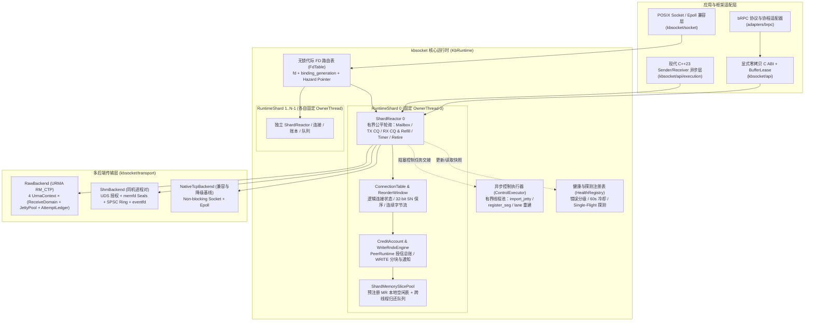

### 3.2 代码目录结构与模块职责映射

为保证代码可读性、可维护性与最小耦合，项目源码按职责严格分层：

| 目录 / 模块 | 核心类 / 接口 | 职责边界 |
| :--- | :--- | :--- |
| `kbsocket/base/` | `log.hpp`, `no_destructor.hpp`, `scope_exit.hpp`, `error.hpp` | 基础工具、统一 `Error` 类型定义、RAII 守卫；严禁依赖上层传输或业务 |
| `kbsocket/api/` | `kbsocket.h`, `buffer.h`, `execution/` | 对外 C ABI、显式 `BufferLease` 零拷贝接口、C++23 P2300 `sender`/`receiver` 封装 |
| `kbsocket/memory/` | `storage.hpp`, `registered_slab.hpp`, `buffer_lease.hpp`, `quarantine_ledger.hpp` | 页对齐虚拟内存、多 `UrmaContext` MR 注册、分片空闲池、跨线程无锁归还队列、未终结 DMA 隔离账本 |
| `kbsocket/transport/raw/` | `urma_api`, `device_catalog`, `urma_context`, `raw_runtime`, `jetty_pool`, `attempt_ledger`, `tx_sender`, `tx_completion_processor`, `rx_buffer_pool` | 裸设备发现、队列池（主动 TX Lane + 被动 RX Endpoint）、逐 WR 账本、全 Signal `SEND`/`WRITE` 提交与完成推进 |
| `kbsocket/transport/shm/` | `shm_broker.hpp`, `shm_pair.hpp`, `shm_ring.hpp`, `shm_backend.hpp` | 同机身份校验、`memfd` 封印管理、跨进程 Cacheline 对齐 SPSC 环与 `eventfd` 通知 |
| `kbsocket/transport/tcp/` | `native_tcp_backend.hpp` | 标准非阻塞内核 TCP 封装，提供握手通道及加速不可用时的保底传输 |
| `kbsocket/control/` | `control_executor.hpp`, `handshake_fsm.hpp`, `endpoint_cache.hpp`, `health_registry.hpp` | 异步 TCP 建链协商、远端 `rjetty`/`rseg` 导入缓存（Single-Flight）、慢控制调用卸载、故障冷却与探测 |
| `kbsocket/connection/` | `connection.hpp`, `wire_format.hpp`, `reorder_window.hpp`, `credit_account.hpp`, `write_rndv.hpp` | 线协议编解码、32-bit SN 乱序重排、连续可读流交付、`PeerRuntime` 分层流控、单边 `WRITE` RNDV 状态机 |
| `kbsocket/runtime/` | `kb_runtime.hpp`, `runtime_shard.hpp`, `shard_reactor.hpp`, `mailbox.hpp`, `timer_wheel.hpp` | 进程级实例管理、单线程 Owner 事件循环、跨线程有界提交队列、O(1) 时间轮 |
| `kbsocket/socket/` | `fd_table.hpp`, `socket_adapter.hpp`, `epoll_mux.hpp` | Hazard Pointer + 代际保护的 FD 表、POSIX `read`/`write`/`writev` 语义、合成与原生 `epoll` 公平复用 |
| `kbsocket/observability/` | `shard_metrics.hpp`, `usdt_probes.hpp` | `alignas(64)` 分片无锁计数器、`<sys/sdt.h>` USDT 静态探针定义 |
| `adapters/brpc/` | `brpc_kb_socket.hpp` | 对接 bRPC 的外部适配器（核心库绝不反向包含 bRPC 头文件） |

### 3.3 并发模型：单 Owner 完整资源闭环

在 V1 中，**一个 `RuntimeShard` 绑定一个 `ShardReactor`，固定运行在一个 OS `OwnerThread` 上**。单 Owner 约束覆盖该分片内物理与逻辑状态的完整闭环：

1. **物理队列独占**：所属 `JettyPool` 的 `Reserve`/`Commit`/`Cancel`/`Complete`、`TxSender::Send`/`Write`、`TxCompletionProcessor::Poll`/`Flush`，以及所属 `RxBufferPool` 的 `Poll`/`Refill`/`Release` 仅由该 `OwnerThread` 调用，底层队列启用 `lock_free = 1`。
2. **连接与协议状态独占**：归属该 Shard 的所有 `Connection` 的发送排队、SN 分配、接收 `ReorderWindow`、可读边界推进、`CreditAccount` 账目及 `WriteRndvEngine` 状态仅由该 `OwnerThread` 修改。
3. **跨线程零锁交接**：
   - 当调用线程即为目标 `OwnerThread` 时，可在状态一致且不重入 post/poll/账本更新的边界内联执行；来自完成回调的重入请求先进入有界待办队列；
   - 当外部业务线程（如 bRPC worker）发起 `write`/`read`/`close` 或归还 `BufferLease` 时，将预分配的操作描述符推入目标 Shard 的有界 `alignas(64)` MPSC `Mailbox` 或 `LeaseReturnQueue`，由 `OwnerThread` 批量消费。
4. **慢控制调用剥离（`ControlExecutor`）**：`urma_import_jetty`、`urma_unimport_jetty`、`urma_register_seg`、`CreateJetty`/`DeleteJetty` 等可能阻塞的控制面 API 交由有界 `ControlExecutor` 执行，完成后通过 `Mailbox` 将结果交回 `OwnerThread` 发布。创建/注册只处理尚未发布的资源；销毁前由 Owner 冻结目标、结束数据面访问并建立第 5 节的终结屏障，控制任务持有其 context、队列、MR 等依赖。执行器不并发修改活动队列和 owner 账本；关闭或代际变化后返回的结果只能清理，不能重新发布。`lock_free=1` 仅适用于单 Owner 的队列操作，不取消共享 context 对象表或 provider 控制面的同步要求。
5. **4 CPU 容器的默认分片配置**：
   - **基线配置（1 I/O Shard + 3 业务 CPU）**：1 个 `RuntimeShard` 统一管理 4 个 `UrmaContext`（共 4 个 `JettyPool` / `ReceiveDomain`），适合 1000 QPS 稀疏控制与常规吞吐；
   - **高吞吐配置（2 I/O Shards + 2 业务 CPU）**：2 个 `RuntimeShard` 各独占 2 个 `UrmaContext`（按 IOdie/NUMA 亲和分配），不跨 Shard 共享任何 `JFR`/`JFC`。
   - 建链时按 `PeerRuntimeId` 一致性哈希将同一远端实例的所有 Socket 固定路由到同一个本地 `RuntimeShard`，从而在分片内零锁共享同一份 `PeerRuntime` 授信与导入句柄。

---

## 4. 分层身份体系、FD 安全与双轨生命周期

### 4.1 分层防 ABA 身份契约

针对历史 `ubsocket` 中因 FD 复用、槽位循环复用和队列重建引发的 ABA 错乱，V1 严格区分以下身份（热路径聚合存储，不增加多余间接寻址）：

| 身份标识 | 位宽与结构 | 作用域与防 ABA 职责 |
| :--- | :--- | :--- |
| `RuntimeInstanceId` | `uint64_t`（节点标识 + 启动时间戳/随机数） | 唯一标识一个 `KbRuntime` 进程实例；握手、流控总账与 SHM 配对的根身份 |
| `ContextIncarnation` / `PoolEpoch` | context / 池每次创建或重新打开时递增的实例代次 | 区分同一对象地址、context 索引或池槽位的先后生命周期；导入缓存、MR、Lane 和账本均绑定所属实例 |
| `FdBindingId` | `int32_t fd` + `uint32_t binding_gen` | 区分同一整数 `fd` 的先后绑定，防止迟到的 `epoll` 就绪或异步回调命中复用后的新连接 |
| `SessionId` (`ConnId`) | `uint32_t conn_slot` + `uint32_t conn_gen` | 在所属 `RuntimeShard` 内唯一定位一条逻辑连接；每次新建连接递增 `conn_gen`，断链重连必为新 `SessionId` |
| `ReceiveDomainId` | `uint16_t ctx_idx` + `uint16_t domain_id` + `uint32_t domain_gen` | 标识共享 `JFR` 与被动接收端点 `rx_target_jetty`；远端据此绑定 `CreditAccount` |
| `JettyLaneId` | `const JettyPool*` + `PoolEpoch` + `uint32_t lane_idx` + `uint64_t lane_gen` | 标识池内单条主动发送 SQ；**单条故障 Lane 重建仅递增该槽位的 `lane_gen`**，不使池内其他健康 Lane 的票据失效 |
| `AttemptId` (`user_ctx`) | `uint64_t`（账本生命周期内单调递增，0 无效，取模定位槽位） | 在所属完成域/账本中 O(1) 定位单次物理提交；必须校验完整 ID、池代次与 Lane 代次，取模位置本身不是身份 |
| `OpId` | `uint32_t op_slot` + `uint32_t op_gen` | 定位单次异步读写或 RNDV 操作状态机（Operation State） |
| `BufferLeaseId` | `const Pool*` + `PoolEpoch` + `uint64_t lease_id`（按容量步进递增） | 唯一标识一次 DMA/共享内存切片借用；拒绝迟到 CQE 或应用重复 `Release` |
| `GrantId` | `uint32_t grant_slot` + `uint32_t grant_gen` | 标识 `WRITE RNDV` 暴露给远端写入的目标内存区间授权周期 |

所有有限位宽的身份计数都必须有耗尽策略：在仍可能存在旧 CQE、回调、远端授权或归还请求时禁止回绕复用；达到上限时停止对应槽位准入，只有完成旧实例的全部终结与事件屏障后才建立新实例。软件对象地址或硬件 ID 相同均不能代替实例身份；SN 的耗尽策略另见第 6 节。

### 4.2 FD 路由表与 Hazard Pointer 读者保护

应用线程通过整数 `fd` 调用 `read`/`write`/`close` 时，不能直接锁全局表或裸读指针后再加引用计数（存在 TOCTOU 竞态）：

1. `FdTable` 为预分配的平铺数组（支持到 `RLIMIT_NOFILE`，默认按块惰性映射），每个槽位原子发布不可变的 `FdBinding` 指针。
2. 任意应用线程查询 `fd` 时，使用线程本地 **Hazard Pointer** 保护加载出的指针并重检槽位一致性；在成功校验 `binding_gen` 并将请求推入目标 Shard 的 `Mailbox`（或取得受控操作句柄）后，立即退出 Hazard 保护，**绝不跨阻塞等待长期持有 Hazard 指针**。
3. `close(fd)` 解绑槽位后，旧连接对象进入所属 `RuntimeShard` 的本地退休队列（`RetireQueue`），由 `ShardReactor` 在满足双轨回收条件后批量释放，彻底消除全局 `deferred_mutex`。

### 4.3 CPU 生命周期与硬件 DMA 生命周期严格分离

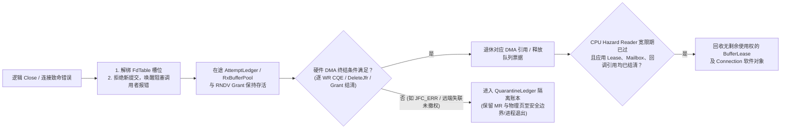

**核心安全铁律**：
- 普通 `write()` 若调用者传入非注册临时栈/堆内存，必须在返回前拷入预注册 TX Staging Slice；若通过显式零拷贝 `BufferLease` 接口提交，即使连接中途报错或被取消（`stop_token`），**在未取得对应 TX WR 的终结证据前，绝不能通知上层 `source_reusable`**。
- **60 秒端口冷却到期、TCP 控制连接断开、软件超时均不是硬件停止 DMA 的证明**，绝不能作为释放或复用在途 DMA 内存的依据。
- CPU 对象回收还必须等待所有已接受 Mailbox 操作、应用借用及完成回调退出；完成回调可能立即销毁 Operation State，调用后不能继续访问它。隔离账本同时持有 MR、backing、provider/context 等完整依赖，并由有界预算约束；不能只保留内存地址却销毁其所依赖的资源，也不能先停掉唯一进度线程再等待它负责的资源归零。

---

## 5. Raw URMA 资源池：收发 Jetty 解耦与故障自愈

### 5.1 关键架构改进：被动接收端点（RX Endpoint）与主动发送通道（TX Lanes）解耦

在 `RM_CTP` 模式下，如果让同一个 `urma_jetty_t` 既作为本端发送 WR 的主动 SQ，又作为导出给 3000 个远端 Peer 导入（`urma_import_jetty`）的被动接收目标，会面临致命的硬件耦合风险：
- 一旦该 Jetty 在向某一个异常 Peer 发送时触发芯片缺陷 **`status 9`（`ACK_TIMEOUT`）**，按硬件契约必须执行 `ModifyJetty(ERROR) -> Flush -> DeleteJetty -> CreateJetty`；
- 如果其余 Peer 也依赖该导出目标，删除会使这些导入关系失效，可能扩大连接故障；具体错误码和影响时序须按完成证据判断，不能保证全部只返回 status 8。

为此，V1 在每个 `ReceiveDomain`（对应 1 个 `UrmaContext` 下的共享 `JFR` + `RX JFC` + `TX JFC`）内实施**收发 Jetty 物理职责解耦**：

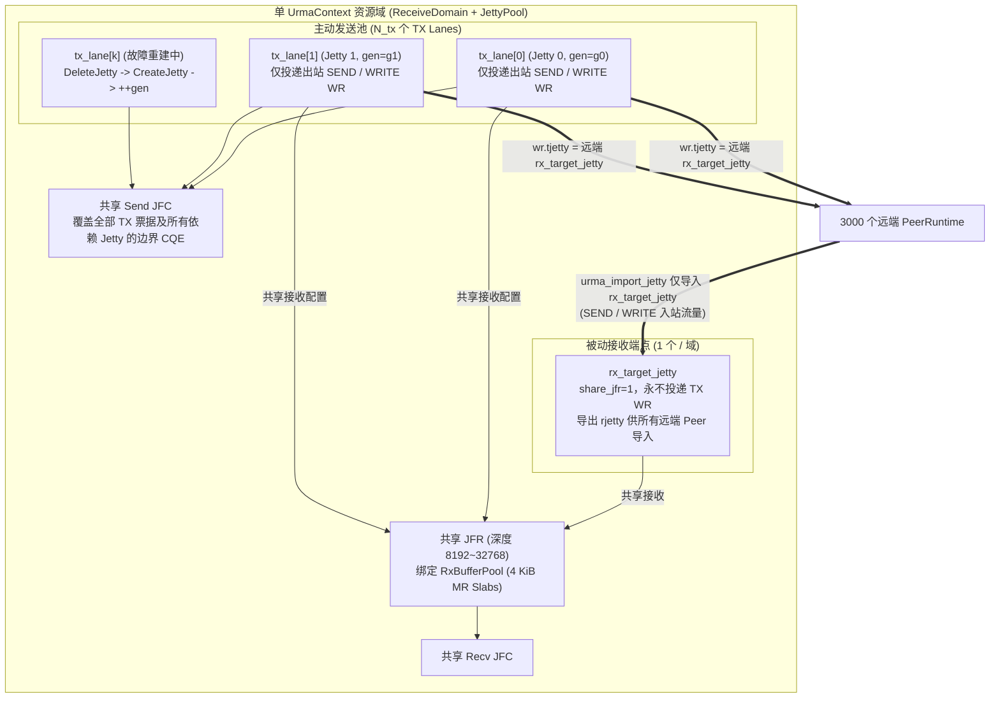

**解耦带来的三重核心收益**：
1. **避免主动 SQ 重建使被动目标失效**：`rx_target_jetty` 从不投递发送 WR，不承担主动发送触发的 `status 9` 重建；其 `jetty_id` 在健康 `ReceiveDomain` 生命周期内保持不变。这不保证共享故障 Lane 上的其他连接不受影响，也不隔离 JFC/context 级错误。
2. **健康接收域内的 TX Lane 本地替换**：主动 `tx_lane[i]` 遭遇 `status 9` 时，完成排空、旧事件终结及删除屏障后重建并递增 `slot.generation`，无需远端重新导入未改变的 `rx_target_jetty`；旧连接仍显式失败，替换不恢复旧会话或重放请求。
3. **远端导入规模降低 $J$ 倍**：每个对端 `PeerRuntime` 在每个可用 `ReceiveDomain` 上只需调用 **1 次** `urma_import_jetty`（而非池内每个 Jetty 导入一次），大幅降低 40k 连接下的内核/驱动 CTP 导入表开销与建链时延。

容量预算必须包含新增被动 Jetty 的资源：TX CQ 至少覆盖所有主动 Lane 的软件票据上限与所有依赖 Jetty 可能产生的边界 CQE，不能遗漏被动端点；RX CQ 覆盖该域可在途 RQE 的最坏完成量及所需事件余量。按实际创建配置校验，不能用 provider 偶然多接受的容量扩大软件准入。

M2 的 `JettyPoolConfig::jetty_count` 只表示主动 TX Lane 数量，实际创建数为 `jetty_count + 1`，须不超过 `cap.max_jetty`。固定被动端点请求 `JFS.depth = 1`，不提供发送票据，永不向其提交 TX WR；TX CQ 创建前校验 `jetty_count * (tx_depth + 1) + 1 <= tx_cq_depth`，为所有主动和被动 Jetty 分别预留边界 CQE。例如两个深度 128 的主动 Lane 至少需要 259 个 TX CQ 条目。provider 实际分配更大的 SQ 不扩大软件票据上限。

`rx_target_jetty_id()` 导出包含 EID 等字段的完整 `urma_jetty_id_t`，仅在池就绪时有效；`IsReceiveJetty(local_id)` 同时识别固定端点及当前有效主动 Jetty，以兼容旧工具向主动 Jetty 发起的流量。生产连接只发布固定端点，不能依赖待替换主动 Lane 继续作为远端目标。创建顺序为 JFC/JFR、固定被动端点、主动 Lane；全域关闭时逆序删除主动 Lane，再删除被动端点、JFR 与后续依赖。主动 Lane 替换不删除被动端点、JFR 或 JFC。

### 5.2 发送完成处理与逐 WR 错误作用域（M2 核心规范）

`TxCompletionProcessor` 在消费 `Send JFC` 时，必须严格遵守**先验明正身、再变更状态**的次序，并按硬件实测证据精确划分错误作用域：

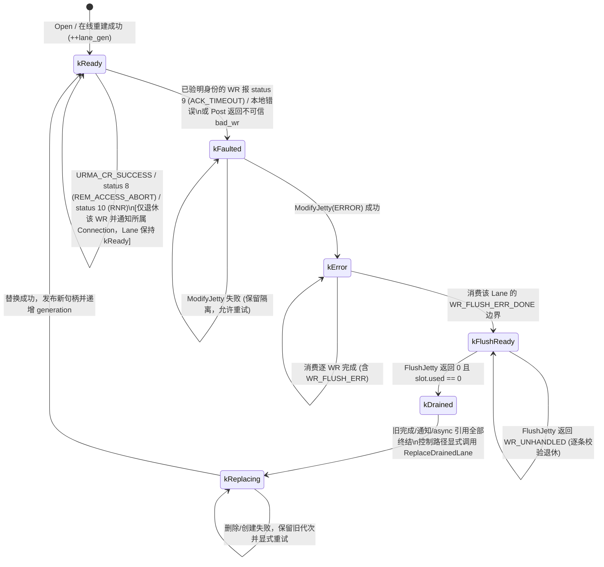

**关键实现不变量**：
1. **身份校验优先于通道状态变更**：
   - 对于普通 WR 完成事件（非 `FLUSH_ERR_DONE`/`SUSPEND_DONE`），先校验 TX 方向、终结类型和所属完成域，再通过 `ledger_.LookupPosted(cr.user_ctx)` 取得已 Commit 的完整 `AttemptRecord`，核对 pool、index、epoch、generation，**通过后才允许根据错误码触发 `BeginDrain`**。未知、重复、未提交或错 Lane 的 CQE 不改变 Lane 状态；不能由取模槽位或 `local_id` 单独确认真实 WR 身份。
2. **边界事件的硬件 ID 复用屏障**：
   - `WR_FLUSH_ERR_DONE` / `SUSPEND_DONE` 的 `user_ctx` 无效，不能按普通 WR 查账或释放票据。除校验所属完成域、`local_id` 和允许接收该边界的状态外，替换前还必须证明旧边界、flush、JFCE/async 通知及其软件引用均已终结，或取得 provider 销毁会清理旧事件的明确保证；**仅按 `Drained -> DeleteJetty -> CreateJetty` 顺序执行不能自动证明硬件 ID 复用安全**。无法建立屏障时保留旧映射/隔离状态，不开放同 ID 新对象。
   - 当前实现只在 `kError` 消费 `FLUSH_ERR_DONE` 并转入 `kFlushReady`；`SUSPEND_DONE` 仅作为已隔离 `kFaulted` / `kError` / `kFlushReady` Lane 的诊断，不触发 `BeginDrain`，也不替代 flush 边界。READY Lane 遇到这些无代次边界只报告异常，不能据此排空新对象。
3. **`status 8` 与 `status 10`（RNR）不排空共享 SQ**：
   - `URMA_CR_REM_ACCESS_ABORT_ERR`（8）与 `URMA_CR_RNR_RETRY_CNT_EXC_ERR`（10）均调用 `ledger_.Complete(cr.user_ctx)` 归还 SQ 票据，并将错误连同 `AttemptRecord` 交由上层处理对应操作/连接，不调用 `BeginDrain`；原本为 `kReady` 的 Lane 保持可提交。`ACK_TIMEOUT`（9）及其他需隔离错误在身份确认后启动 ERROR 排空；即使 Modify 失败，已获得可信终结证据的 WR 仍退休，并同时返回控制路径错误。
4. **适用边界**：上图仅用于健康 JFC 上的主动 ERROR/flush；通过完整身份校验的真实 `WR_FLUSH_ERR` 同样是逐 WR 终结证据：在 `kReady` / `kFaulted` 中先隔离并尝试切 ERROR，Modify 失败也保留退休结果；在 `kError` / `kFlushReady` 中直接退休，不重复启动排空或回退阶段；`WR_UNHANDLED` 仅接受来自匹配 Lane 的软件 flush。`JFC_ERR` 导致完成证明不全时转入依赖域隔离，不能套用 `FlushJetty == 0` 或软件计数清零推断安全。M2 已实现上述完成处理与显式 Lane 替换；结果分发到 Connection、自动控制任务调度和完整故障 CQ 回收不在本次交付范围。

#### M2 Lane 替换与调用责任

`JettyLane` 的身份由 pool 指针、池 epoch、Lane index、Lane generation 组成。每次 `Open` 使用新的 epoch，初代 Lane generation 为 1；`ReplaceDrainedLane(old_lane, quiescence)` 只更新目标 Lane generation，不使健康 Lane 的票据失效。epoch、generation、票据 sequence 耗尽时拒绝回绕；账本的单调 AttemptId 与提交序号规则保持不变。

替换要求目标 Lane 已达到 `kDrained` 且无在途票据，并由调用方给出以下三项持续有效的事实。raw 接口仍为同步控制原语；M3 的 `RuntimeShard::RequestReplacement` 在取得显式证明后交给 `ControlExecutor`，执行期间暂停该 context 的全部 owner 访问，其他 context 继续推进。数据面不能自行调用创建/删除，也不自动重放旧请求。

| `JettyLaneQuiescence` 字段 | 替换前及失败重试时必须成立的条件 |
| --- | --- |
| `events_acked` | 旧对象的通知及 async 事件已 Get/Ack，没有待处理事件引用 |
| `queue_users_stopped` | 旧对象不再被 post/poll、缓存句柄或其他软件引用访问；旧主动对象若曾作为接收目标，其入站访问也已停止 |
| `completions_drained` | 旧 WR、边界与软件 flush 均已收敛，旧对象的 CQE 及已取出的软件完成不再进入共享 CQ 处理路径 |

调用后先封禁为 `kReplacing`，旧 ID 不再通过 `FindLane` / `IsReceiveJetty` 路由；随后删除旧 Jetty，并用 Open 时保存的配置创建新 Jetty。删除失败保留句柄，创建失败保留空槽，两者都保持旧 generation；成功删除的句柄不会重复删除。显式重试必须仍携带匹配的旧 Lane 身份与三项证明，只有新对象创建成功才递增 generation 并恢复 `kReady`。旧票据或控制操作不能作用于新代次，即使 provider 复用了硬件 ID。

共享 JFC 在局部替换期间仍服务健康 Lane，因此上述证明必须覆盖旧对象的全部 CQE/引用，不能仅靠停止旧 ID 的软件路由保证 provider 解析安全。全域关闭取得独占权或停止 TX 准入后禁止替换；域关闭可以继续删除 `kReplacing` 的剩余句柄，但不重新创建 Lane。固定被动端点始终保持原身份，直到整个接收域关闭。以上为 raw 实现及 Mock 覆盖范围，本轮 UB 真机回归尚未执行。

### 5.3 接收域安全关闭状态机（M1 核心规范）

针对整个 `ReceiveDomain` 关闭时共享 `JFR` 内仍有未消费 `Posted` RX WR 的问题，基于已确认的 `DeleteJfr` 硬件契约，执行以下依赖顺序。单连接关闭和单 TX Lane 重建不删除共享 JFR。图示为 Owner 协调的逻辑顺序，可能阻塞的 provider 销毁/注销调用按 §3.3 交给控制执行器完成后再推进下一阶段。

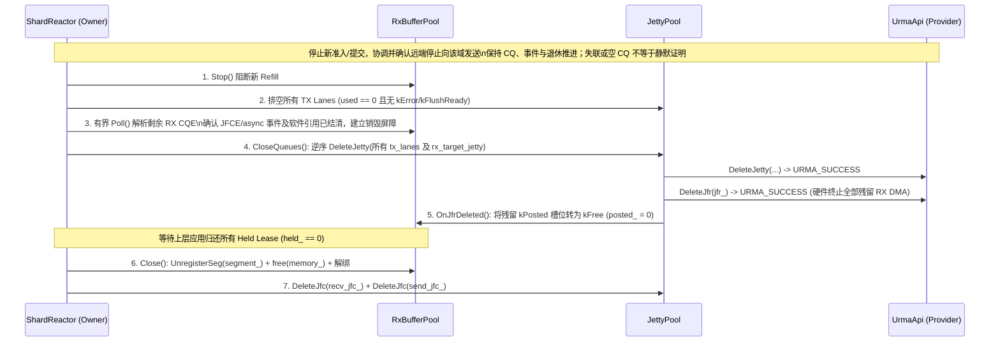

- **剩余完成与授权**：销毁前在 provider 对象仍有效时解析相关 CQE，并取得通知/async 的确认屏障；销毁竞态中的剩余完成必须有明确的 provider 清理或安全解析契约覆盖，无法证明则保留依赖。不得先删除对象再通过它解析迟到 CQE。`DeleteJfr` 成功只终结残留 Posted RX，不伪造成功 CQE、不撤销 Held Lease，也不终结独立 RMA Grant；MR 注销/内存释放还须等待这些条件结清。
- **失败可重试**：若任一 `DeleteJetty`、`DeleteJfr` 或 `UnregisterSeg` 返回非零错误，保留当前阶段状态与底层依赖（绝不提前 `free(memory_)`），允许后续重试从断点继续推进。正常关闭门槛无法满足或 JFC 已故障时采用隔离；该流程不能把软件超时当作 DMA 终结证明。

#### M1 raw 实现与调用责任

当前入口为 [`ReceiveDomainCloser`](../../kbsocket/transport/raw/receive_domain_closer.hpp)。它是借用 `JettyPool` / `RxBufferPool` 的单 owner 控制对象，关闭过程中两池、context、MR 及本协调器必须持续存活；析构不自动推进硬件销毁。M3 已接入事件消费与异步控制执行器，`RuntimeShard::Close` 只解绑进度源，不替代接收域销毁协议。完整远端控制协议仍待 M5，不以空 CQ、断链或等待超时自动构造静默证明。

1. `Begin(pool, buffers)` 取得该域的独占关闭权，只停止 TX `Reserve` / `ReserveOn` / `Get`。现存票据仍可 `Commit`、`Cancel`、`Complete`，TX poll/ERROR/flush 继续可用；RX `Poll` / `Release` / `Refill` 在确认远端静默前继续可用，避免关闭握手期间因提前停止补投而制造 RNR。这些操作由同一 owner 串行推进。
2. `Advance(quiescence, events)` 首次收到 `peer_stopped = true` 后调用 RX `Stop`，该停止不可逆，远端静默须持续至关闭完成。在 `kDraining` 阶段每次执行一次有界 RX poll，最多消费 `RxBufferPool::kPollBatch` 项，并通过 `rx_events` 返回本次事件数。出现 RX 事件时当次不进入删除，调用方须处理每个返回事件，包括带错误但持有 lease 的事件。TX 票据退休和 ERROR/flush 完成仍由调用方负责。RX poll 失败则进入 `kRetained` 并封禁整个域的队列推进；后续 `Advance` 只报告保留错误，直接 TX/RX poll 也被禁止，仅允许已有 Held lease 归还。此阶段不继续 TX 退休或尝试故障 CQ 回收，整个依赖链保留至退出。
3. 在确认静默、事件/软件引用屏障、正常 CQ，以及观察到 RX poll 为空且所有 TX lane 已排空后，协调器进入 `kDeletingQueues`。它通过私有 `CloseQueues()` 逆序删除全部 jetty，再删除 JFR。私有 `OnJfrDeleted()` 只在实际删除成功后清退残留 Posted，累计到 `retired_rx` / `retired_on_delete()`，不计作成功接收；Held 的内容和 lease 不变。
4. `kWaitingForLeases` 等待 Held 归还，再注销 RX MR、释放 backing 并解绑；`kDeletingCompletionQueues` 依次删除 RX/TX JFC，最终进入 `kClosed`。成功阶段不重复执行；删除/注销失败保留错误、阶段和未释放依赖，下次 `Advance` 继续。进入删除阶段即停止 provider poll，即使删除失败也不能恢复收发。池仍绑定协调器时，普通 `Close()` 被独占关闭权阻挡，不能绕过上述顺序；RX 内存已经关闭并解绑后，单独 `RxBufferPool::Close()` 可幂等返回成功，余下 JFC 仍由协调器关闭。

`ReceiveDomainQuiescence` 是调用方对外部事实的明确声明，四项默认 false；它不是测试开关或强制回收标志。事实须在进入删除阶段前成立，并保持至关闭完成：

| 字段 | 调用方必须证明的条件 |
| --- | --- |
| `peer_stopped` | 所有远端已停止向该接收域发送；首次确认便停止 RX 补投，此后至关闭完成均不得再恢复远端发送。连接 EOF 或空 CQ 本身不构成证明 |
| `events_acked` | 与待销毁对象关联的 JFCE/URMA async 事件已经 Get/Ack，未持有待确认事件对象引用；纯 poll 配置也不能忽略 context async 责任 |
| `queue_users_stopped` | 除当前 owner 推进排空和被单独计数的 Held lease 外，其他调用方已停止访问队列/注册内存且引用责任结清；不存在由此流程无法终结的独立 RMA 授权 |
| `completion_queues_healthy` | 当前为可正常解析、按 provider 契约销毁的 CQ；发生 JFC 错误或完成证据丢失时不能设为 true |

源码依据与适用范围：本地 UMDK `32a1386b72b3b4a890c89d397f7f6d510564b7a9` 的 [UDMA jetty 删除](../../../umdk/src/urma/hw/udma/udma_u_jetty.c) 和 [JFR 删除](../../../umdk/src/urma/hw/udma/udma_u_jfr.c) 在释放队列前调用 [`udma_u_clean_jfc`](../../../umdk/src/urma/hw/udma/udma_u_jfc.c)，按本地对象 ID 清除残余 CQE。该清理仅覆盖普通、非 custom JFC，当前 raw 池采用此配置；被清除的 CQE 不再交给应用。删除失败路径也可能移除 provider 对象表项，故只能继续销毁重试，不能重新 poll 旧对象。该源码契约覆盖最后一次 poll 与删除之间的残余 CQE，不能替代远端静默和事件确认，也不扩展到故障 CQ。此项为本地源码核对，不构成本轮真机 PASS；新关闭流程的 UB 真机回归尚未执行。

---

## 6. 连接内顺序：保留薄适配，不构建重放协议

### 6.1 64-Bit `IMM` 紧凑线协议与完整身份扩展

**M4.2 已交付**：`wire_frame.*` 实现下述 IMM 布局、规范短/扩展身份和 Eager/piggyback/CREDIT/FIN/RST；payload 多字节字段使用大端，IMM 是 URMA 数值，不再次做 `htonll`。扩展时 IMM 的 slot/gen 位清零，slot/gen 可用紧凑格式时不接受冗余扩展编码。CREDIT body 固定 48 B，依次为 session、credit_epoch、max_credit_seq、max_control_credit_seq、max_frame_seq、max_stream_bytes 六个 u64；FIN body 为 session u64，RST body 为 session u64 + 非零 reason u32，均可再前置 8 B 扩展身份。`EncodeWireHeader` 仅输出头部供独立注册 SGE 组合，短 DATA 无 payload 头。RNDV 类型已预留但当前拒绝解析/编码，待 M6 冻结。具体接口及完整来源校验前提见 [连接协议原语](../connection-primitives.md)。

`RM_CTP SEND` 的单 WR 硬件上限为 **4096 字节（含 payload 内头部）**。每帧前置协议头会使 4096 B 独立写入需要分片；这增加 WR/CQE 数量，但吞吐影响仍须测量，不能直接推导为减半。紧凑编码是优化，完整身份校验优先。

`kbsocket` 利用 `URMA_OPC_SEND_IMM` 提供的 **64 位带外立即数（`imm_data`，不占用 4096 B 载荷空间）** 与接收 CQE 的 `cr.completion_len`（实际字节数），在满足紧凑身份条件且无捎带头时实现 **0 字节 payload 头部开销**：

| IMM 位段 | 字段 | 含义 |
| --- | --- | --- |
| 63..60 | `FrameType`（4 位） | 数据、捎带授信或控制类型 |
| 59..56 | `Flags`（4 位） | 类型相关标志；bit 3 固定为 `kExtendedIdentity` |
| 55..48 | `ConnGenShort`（8 位） | 仅允许完整 `conn_gen` 在 1..255 时直接编码，**禁止截取高代际低位复用** |
| 47..32 | `DstConnSlot`（16 位） | 单 Shard 至多 65536 个紧凑连接槽，覆盖 40k 目标 |
| 31..0 | `FrameSeq / SN`（32 位） | 连接方向内逻辑序号 |

连接完整身份仍为 32-bit slot + 32-bit generation。slot 超出 16 位或 generation 超出 255 时，**所有帧类型**设置 `kExtendedIdentity`，payload 首先携带 8 B `ExtConnHeader`（完整 slot/gen），再跟类型相关头和数据；完整代际溢出前停用槽位，不允许回绕。紧凑 `(slot, gen)` 在同一接收域 incarnation 内不得重新分配；不能依赖软件超时证明旧帧已消失。接收域重建也须遵守 §4–5 的身份和事件终结屏障。

握手绑定 runtime 实例、接收域代际、wire 版本和完整 Session；RX 解复用先校验所属域及已协商的来源，再校验完整或无歧义紧凑身份。旧连接 tombstone 保留授信归属，迟到帧不进入新连接。M4 冻结字节序、各类型长度及标志组合，逐字段编解码，禁止直接发送宿主 C++ 结构体布局。

- **`FrameType` (Bits 63..60)**：
  - `0x0` (`kDataEager`)：普通 Eager 数据帧。无扩展身份时可承载 4096 B 业务数据；有扩展身份时最多 4088 B，数据长度由 `cr.completion_len` 扣除头部后得到。
  - `0x1` (`kDataWithPiggybackCredit`)：携带捎带授信的 Eager 数据帧。payload 前置 8 字节紧凑 `CreditHeader`，后跟最多 4088 B 业务数据。
  - `0x2` (`kControl`)：纯控制帧（`CREDIT_UPDATE`、`RNDV_RTS`、`RNDV_GRANT`、`RNDV_DONE`、`FIN`、`RST`）。`Flags` 低 3 位指定子类型，控制头携带相应 epoch、transfer/grant 等完整身份；长度按冻结格式校验，不预先承诺所有 MR 描述符都能塞入 64 B。
- **`Flags` (Bits 59..56)**：
  - 对于数据帧：`bit 0 = kFlagFirst`（消息首片），`bit 1 = kFlagLast`（消息末片），`bit 2 = kFlagUrgent/Solicited`。
  - 对于 `kControl` 帧低 3 位编码具体控制指令码；所有帧 bit 3 均为扩展身份标志。扩展头可由独立注册 SGE 拼接，但计入 4096 B 上限，带扩展身份的捎带授信帧最多承载 4080 B 业务数据。
- **`FrameSeq / SN` (Bits 31..0)**：
  - 每个逻辑连接每个方向独立维护序号：每个 Eager WR 占 1 个 SN，RNDV 在开始时预占 1 个 SN，DONE 完成该占位，FIN 占 1 个终结 SN。纯 CREDIT/RTS/GRANT 等控制不额外消耗数据顺序空间，其幂等由控制 epoch/事务身份维护。
  - SN 在 provider 调用前确定并入账；明确未接受后缀保留原 SN，禁止后续数据绕过该后缀形成永久空洞；已接受失败或接受范围未知则显式失败，不重放。
  - V1 在 32-bit SN 耗尽前停止接受新数据，保留终结 SN 并有序关闭，由上层建立新 Session；不允许在同一 Session 内静默绕回。以后若支持模序号，须另行定义小于半序号空间的窗口与旧帧寿命约束。

### 6.2 接收乱序重排窗口（`ReorderWindow`）与连续流交付

**M4.2 原语边界**：`TxSequenceWindow` 在 post 前预留连续 SN，可信部分接受只推进前缀，后缀保留原 SN 阻挡新批次；接受未知永久停止准入，最高 SN 仅供 FIN。`ReorderWindow` 保存真实 raw/Slab Lease 描述符，成功 Push 才接管，按预算 Poll 交付并发出 receipt；应用实际归还 Lease 后 Release(receipt) 才释放驻留预算。当前实现保守地发布 `max_frame_seq = min(released_prefix + W, 2^32)`，使未消费前缀继续占描述符容量；`max_stream_bytes` 为累计已消费 payload 字节加驻留上限（溢出时饱和），发送端累计接受字节不得越过该上界。TX 完成不会放开这两项远端窗口。窗口本身不实现 raw 来源路由或协议 RNDV 授权验证。

由于同 SQ 同目标的 `RM_CTP SEND` 可能乱序到达，接收端每个 `Connection` 维护固定容量的环状重排窗口（基线 $W = 64$，协商可调，预分配描述符，零堆分配）。发送方须同时满足接收端发布的独占上界 `sn < max_frame_seq` 与驻留字节上限，接收端保证 `max_frame_seq <= rcv_nxt + W`；不得仅凭 PeerRuntime credits 或本地 TX CQE 越过对端重排窗口。该流控进度不确认业务执行，也不用于重放。延迟 RNDV 占位同样计入 W，防止后续 Eager 在合法发送下把窗口冲破。

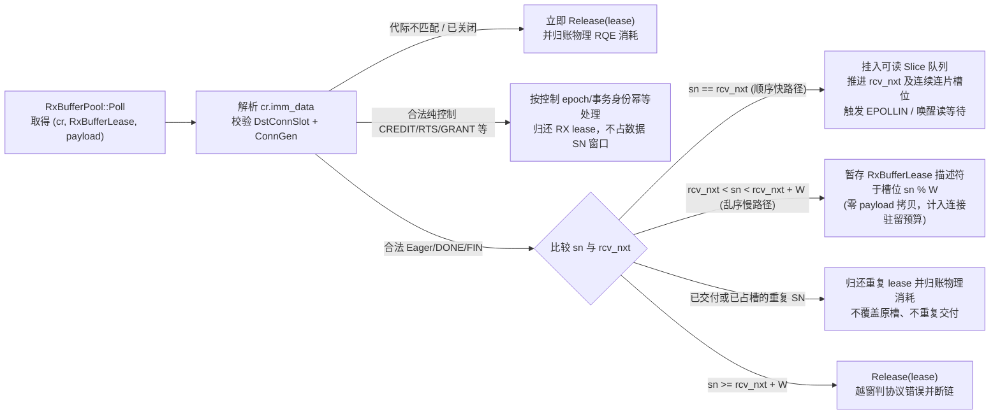

- **RNDV 与 Eager 统一保序**：当 `WRITE RNDV` 完成后，发送端发出的 `CTRL_RNDV_DONE` 通知帧同样携带其在发送顺序流中分配的 `sn`。只有当 `rcv_nxt` 推进到该 `sn` 且 `WRITE` 所有 Chunk 校验完成时，该大包对应的目标 `BufferLease` 才并入连续可读队列，确保后续 Eager 绝不越过未完成的 RNDV。
- **FIN 与异常边界**：`CTRL_FIN` 携带最终 `fin_sn`。仅当前缀无缺口且应用已读尽此前字节后，才报告干净 `EOF`（`read` 返回 0）；对端 FIN 仅关闭对应读方向。乱序缺口超时或 CQE 错误必须显式置错，已验证的连续前缀可先读出，但不能跳过缺口伪造成功。

---

## 7. 注册内存管理与单边 `WRITE` RNDV 大包协议

### 7.1 四层内存模型与零分配快路径

`kbsocket` 将内存管理拆分为四个正交层次，彻底解耦 bRPC `Block`：

1. **`Storage`**：页对齐底层物理内存分配（大块虚拟映射 / Hugepage / THP 预触页，或同机 `memfd` 共享映射）。
2. **`Registration`**：地址区间在所属 `UrmaContext` 实例下的 MR 注册句柄（`urma_target_seg_t*`，按路径配置所需权限）。同一 `Storage` 可按需在最多 4 个 `UrmaContext` 下注册，但各 context 的句柄不能混用；跨 context 注册失败时保留尚未安全撤销的依赖，不发布半成品。
3. **`Slice`**：从预注册 Slab 中切出的定长内存块（如 4 KiB Eager 块、64 KiB / 1 MiB RNDV 大块），归属特定 `RuntimeShard`。
4. **`BufferLease` / `Grant`**：
   - `BufferLease` 跟踪本地 CPU 持有与本地 TX/RX DMA 生命周期；
   - `Grant` 跟踪暴露给远端执行单边 `WRITE` 的访问授权生命周期。
   - **跨线程归还**：当业务线程在不同于 `OwnerThread` 的核上消费完 `BufferLease` 时，将 `BufferLeaseId` 推入该 Shard 预分配的有界无锁 `LeaseReturnQueue`（容量 $\ge$ 最大可借出 Lease 数，杜绝满溢丢弃或动态分配），由 `OwnerThread` 批量回收到本地 Freelist。

映射、预触页和注册均在初始化/控制路径完成，池内借还只更新预分配元数据。扩容先预留容器预算，由控制执行器准备后交 Owner 发布；空池时部分接受、反压或报错，不在收发/poll 路径同步扩容，也不使用未注册 heap 内存绕过限制。活动、Held、扩容中及隔离资源都计入内存上限；同一 backing 多 context 注册时物理字节只计一次。

**M4.1 实现边界**：`SlabAllocator` 目前拥有一个固定容量的页对齐 backing，在最多四个 context 注册，借助共享 `MemoryBudget` 限制 backing 总字节；容量固定的 Lease/引用/隔离/队列元数据及 provider 内部开销不包含在该 backing 计数内。每个 `BufferLease` 只有一份 CPU 所有权，复制描述符不会增引用；每份 DMA/Grant 使用独立 `BufferReference`，经 `Reserve -> Commit -> CompleteDma/EndGrant` 结束，只有明确未暴露的 Reserved 责任允许 Cancel。三类责任全清才复用；不以超时、断链或本地 CQ 清空替代远端 Grant 终结证明。`LeaseReturnQueue` 与 `LeaseReturnProgress` 已接入 M3 hooks，只转移并解除 CPU 持有。当前尚未迁移 `RxBufferPool` backing，也未实现 Slab 扩容管理、应用 write 部分接受及远端 Grant 协议；使用与安全关闭约束见 [注册内存与 Lease](../memory-leases.md)。

### 7.2 三条数据路径与阈值策略

| 数据路径 | 适用条件 | 内存与完成生命周期 |
| :--- | :--- | :--- |
| **1. Copy Eager (`SEND_WITH_IMM`)** | 普通 `write`/`writev`，先以 $16\text{ KiB}$ 作为候选切换阈值；按实际协议头和能力拆成总长 $\le 4096\text{ B}$ 的 WR | `write()` 返回前将已接受前缀拷入预注册 TX Slice，返回字节数只包含已复制数据；TX CQE 退休后回收 TX Slice。RNDV 未启用时，大写入同样以有界分片 copy eager、部分写和反压推进 |
| **2. Zero-Copy Lease Eager (`SEND_WITH_IMM`)** | 调用方通过 `kb_write_lease()` 传入已注册 `BufferLease` 且总长 $\le 16\text{ KiB}$ | 支持多 SGE 直接引用调用方 `BufferLease`，零内存拷贝；必须等待全部关联 TX WR CQE 终结后才触发 `source_reusable` |
| **3. 单边 `WRITE` RNDV** | M6 启用后，对大写入（候选阈值 $> 16\text{ KiB}$）按复制/握手成本测量选择 | 接收端有界准入并分配连续目标注册内存（`max_rsge=1`）；源为有效注册 Lease 时可直接多 SGE `WRITE`。普通 `write`/`writev` 必须先把已接受前缀复制进库持有的注册 staging，不能返回后继续借用调用者内存。全部相关 `WRITE` CQE 成功后才发送 `CTRL_RNDV_DONE` |

阈值是待 benchmark 校准的策略参数，不是硬件能力边界；多 SGE 总长度及数量仍须满足设备限制。应用大于当前 staging/接收预算的写入允许分次接受，不要求一次性保留整个任意大请求。

M2 已在 `TxSender` 提供非 inline、全 signal 的 WRITE raw 提交原语。`TxSendRequest::remote` 必须指定一个远端 SGE（`max_rsge = 1`），其长度等于本地 SGE 总长；本地 SGE 数量不超过创建配置，总长不超过 `min(200 MiB, JettyPool::max_write_size())`。提交前校验本地注册段、导入远端段与目标 Jetty 的 context，以及源/目标 VA 区间和地址算术溢出；远端地址使用对端导出的 VA，不使用 import 的本地 `mva` 或相对偏移。目标、注册段和 payload 由调用方保持至可信终结，buffer/grant 元数据不转移所有权。

同批可以提交 SEND、SEND_WITH_IMM 和 WRITE，继续按 provider 的可信接受前缀入账；接受范围未知时保留整批依赖并停止发送。混批不建立 WRITE 与 SEND 通知的可见性依赖，调用方仍须等待全部相关 WRITE 成功退休再发送完成通知。当前没有自动 DONE、Grant 协商、分块调度或 RNDV 事务状态机；这些由 M6 按下一节协议实现。本轮 WRITE raw 改动尚无 UB 真机回归结果。

### 7.3 为什么剔除 `READ RNDV` 并唯一采用 `WRITE RNDV`

基于第 2.1 节 **H4** 与 **H5**：
1. 用户确认大并发 `READ` 容易触发 `status 9`（`ACK_TIMEOUT`），而大并发 `WRITE` 未观察到这一触发模式；选择 WRITE 可避开已知 READ 风险。**这不保证 WRITE 不会报 status 9**：WF2 首次健康基线 WRITE 就曾返回该错误，原因尚未定位，所有 opcode 均须遵守 Lane 隔离与重建契约。
2. 硬件团队已明确确认 `WRITE` 完成可见性与 `READ` 完全一致。
3. 剔除 `READ RNDV` 后，接收端无需在本地 `Send JFC` 上处理入站数据的 `READ` 完成并回跳接收状态机，收发数据流向在硬件队列上完全正交。

### 7.4 `WRITE RNDV` 完整状态机与安全终结

本节为 M6 待实现协议；M2 的 WRITE 提交/完成原语只提供其底层 WR 能力，不代表完整 RNDV 已交付。

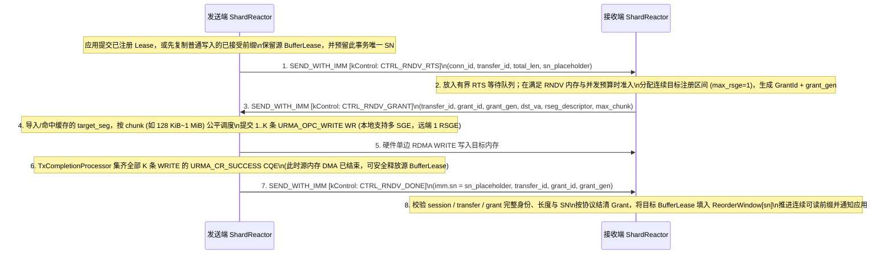

**`Grant` 安全隔离铁律（防迟到 `WRITE` 覆写新数据）**：
- RTS、GRANT、DONE 均绑定完整 runtime/session/transfer/grant 代次及授权区间；RTS 先预留逻辑 SN，后续 Eager 不能占用它。GRANT 的延迟/重复不允许重复提交，DONE 必须代表**已禁止该 Grant 后续新 WRITE，且授权区间所需的全部 Chunk 成功终结**；只看到最后一条 CQE 不足以发 DONE。部分 post 的明确未接受后缀可重试，全部 Chunk 成功后才能发 DONE；任一已接受 WR 失败或接受范围未知则不能发送成功 DONE，也不重放已接受部分。
- 若在步骤 3（发出 `CTRL_RNDV_GRANT`）之后、步骤 7（收到合法 `CTRL_RNDV_DONE`）之前，连接发生超时、取消或断开，**接收端绝不能立即将该目标内存块放回空闲池复用**！因为发送端可能仍有在途 `WRITE` WR 正在向该物理地址 DMA。
- 只有在满足以下任一安全终结条件时，方可回收目标内存：
  1. 收到发送端经可信通道、匹配完整 session/transfer/grant 代次的终结确认：发送 Owner 已封禁该 Grant 的全部后续提交，处理完尚在 Mailbox/排队中的操作，并证明所有已接受 `WRITE` 均已退休/排空。一次本地计数为零或单独的 SQ flush 不代表远端授权已结清；
  2. 或有已验证的硬件契约证明独立 MR 撤权同时阻止后续访问并终结全部在途 DMA。**当前记录没有提供将 `UnregisterSeg` 返回成功直接用作这一证明的契约**，不能据此提前复用。共享 Slab 中的 Slice 也不能单独注销 MR，整段注销前必须结清其他 Lease/Grant。
- 在满足上述条件前，该内存块及其注册/context 依赖记入 `QuarantineLedger` 并计入容器隔离内存硬上限；达上限时限制或拒绝新 RNDV。现有加速连接报错并由上层决定重连，只有新连接可重新选择 NativeTCP，不跨 TCP 搬运旧事务。

---

## 8. 分层流控：守恒总账、长期暖窗口与大包准入

### 8.1 五类独立资源额度

**M4.2 已交付的软件总账**：`SenderCreditAccount` 与 `ReceiveCreditDomain` 分开维护发送侧累计授权和接收侧 F/G/U。接收端只有真实初始 accepted RQE 可授信；每次可信归属 CQE 取得独立 receipt，实际 Lease 归还且对应 refill 被接受后才恢复 F。数据与控制有独立额度，未知 CQE 扣物理 posted 并冻结域，不能猜归属重授。旧 Peer 的 tombstone 保留至域关闭，未结清授权不因逻辑连接关闭归还。当前未接自动 CREDIT 调度、非阻塞 TCP 逃生、RX pool 补投及 M1 销毁回调；账本 Close 不是 DMA 终结证明，不能视为端到端流控已交付。

| 额度类别 | 保护对象 | 耗尽时的行为 |
| :--- | :--- | :--- |
| **1. 本地发送缓存配额** | 单连接待发送字节上限（如 256 KiB） | 非阻塞 `write` 返回部分写或 `EAGAIN`，待数据发出回收后触发 `EPOLLOUT` |
| **2. 物理 SQ 票据（`JettyTicket`）** | 物理 JFS 队列深度（`tx_depth`）与 `Send JFC` 容量 | 挂入 Shard 内活跃连接发送队列，等待 `TxCompletionProcessor` 退休释放票据 |
| **3. 远端接收槽位（`JFR Credits`）** | 对端共享 `JFR` 的已投递 4 KiB 接收槽位 | 暂停投递该对端域的双边 `SEND_WITH_IMM` 数据帧（从源头预防硬件 RNR） |
| **4. 远端连接驻留字节窗口** | 对端单连接未读数据 + `ReorderWindow` 乱序驻留上限 | 暂停该连接的 `max_frame_seq`、驻留字节额度及 Grant 扩展，物理 RQE credits 仍按 PeerRuntime 共账 |
| **5. RNDV 内存与并发 DMA 预算** | 容器级大包目标内存池（如 128 MiB）与并发 `WRITE` 流数 | `CTRL_RNDV_RTS` 描述符在接收端有界排队，按公平策略逐个发放 `CTRL_RNDV_GRANT` |

### 8.2 接收域守恒方程与 `PeerRuntime` 暖窗口（针对 3000 Peer 稀疏负载）

吸收历史 `ubsocket` 每连接 2-credit 导致 10 KiB 首请求（需 3 个 WR）卡顿的教训，同时受限于单 `JFR` 最大 32,768 槽（不能给 40k 空闲连接各发大窗口），V1 以 **`{PeerRuntimeId, ReceiveDomainId}`** 为粒度建立严格守恒账本：

对于接收域 $j$，设 `RxBufferPool` 实际容量与 `JFR` 深度为 $P_j$，控制帧专用保留槽位为 $C_j$（如 512），则普通数据可授信总额度为 $B_j = P_j - C_j$。任何时刻严格满足守恒不变量：

$$F_{\text{elastic}, j} + \sum_{i} \underbrace{(F_{\text{base}, ij} + G_{\text{base}, ij} + U_{\text{base}, ij})}_{q_{\text{base}} = 8} + \sum_{i} G_{\text{elastic}, ij} + U_{\text{elastic}, j} = B_j$$

- **$q_{\text{base}} = 8$（长期基础暖窗口）**：每个已准入的对端 `PeerRuntime` $i$ 在其归属接收域 $j$ 享有 8 个基础 Credits（可覆盖 8 个 1 KiB 请求或 2 个完整的 10 KiB 请求，单次 10 KiB 请求仅需 3 个 4096 B WR）。该额度在**对端实例的所有逻辑 Socket 间本地共享**，新建逻辑连接无需再走网络申请即可立即发出首请求！
- **状态流转守恒**：
  1. **初始/补投**：只有 `RxBufferPool::Refill` **实际被硬件接受（Accepted）** 的 RQE 才能将 $U$（未补投槽位）转化为 $F$（可授出额度）；
  2. **发放授信**：向对端发布 $n$ 个 Credit 前，先执行 $F \gets F - n,\; G \gets G + n$；
  3. **收包扣减**：成功归属到对应授信关系的消耗 RQE 的 CQE（含乱序或旧 Session 帧），执行 $G \gets G - 1,\; U \gets U + 1$。无法归属的错误或畸形 CQE 也须扣除物理可用容量并隔离核账，不能猜测所属 Peer 或无条件增发信用。Held/乱序驻留内存仍不可补投，直到 Release 且实际 refill 成功才恢复 F。
- **3000 Peer 容量核算（4 个 `ReceiveDomain`）**：
  - 3000 个对端均匀归属 4 个接收域（每域 750 个 Peer）：
  - **紧凑配置（每 `JFR` 深度 8192，4 域合计 128 MiB RX Buffer）**：每域 $C_j = 512$，$B_j = 7680$；750 个 Peer 基础承诺 $750 \times 8 = 6000$，剩余 $1680$（四域合计 $6720$）作为公共弹性池 $F_{\text{elastic}}$ 按活跃排队需求动态批授。
  - **宽裕配置（每 `JFR` 深度 32768，4 域合计 512 MiB RX Buffer）**：在上述 Peer 数和均匀归属下可支持 $q_{\text{base}} = 16\sim 32$；RX 本身已占 512 MiB，不能再要求总注册内存低于 512 MiB。
  - 哈希不保证均匀。建链必须检查每域实际剩余额度；紧凑配置每域最多承诺 960 个基础窗口，若需保留弹性容量，准入上限应更低。目标域不足时在建链期另选有容量的域或返回反压，不给已有 Peer 在多个域复制同一份额度。
- **捎带更新（Piggyback）与控制保活**：
  - 等长请求/响应场景下，接收端在完成 `Release` + `Refill` 后，直接在反向数据帧（`FrameType = kDataWithPiggybackCredit`）中携带单调递增的累计授信上限（`max_credit_seq`），零额外控制 WR 开销且天然幂等防丢包/乱序；
  - 单向流或无反向数据时，累计释放达阈值（如 $\ge 4$）或超时通过独立 `CTRL_CREDIT` 帧返还。
  - 通过 UB 发送的控制帧（CREDIT、GRANT、DONE、FIN 等）使用预留的 $C_j$ 预算，**仍须有可兑现的逐域控制授权和本地 SQ 配额**；共享 JFR 不会硬件隔离这些槽，512 个保留槽不能允许 3000 个 Peer 无限制各发一条。RTS 是普通入口需求，扣数据 credits，不能挤占全部保活额度。

**控制进度与旧授信终结**：
- 基线保留有界、非阻塞 TCP 控制通道作为信用更新/撤销和关闭的逃生路径，Reactor 公平推进；UB 控制帧无可用额度时不盲发。RNDV 准入须同时预留 GRANT/DONE 的控制额度；DONE 按已确认的 WRITE 完成后 SEND/IMM 规则提交，不能未经验证改成另一种通知语义。TCP 仅传协议控制，不重放已接受的业务数据。
- 累计授信更新绑定 `{PeerRuntimeInstanceId, ReceiveDomainId, credit_epoch}` 并单调去重；同一 Peer 的所有 socket 共账。发送端预留信用后再 post，只归还明确未接受的后缀；TX 完成、超时或逻辑 close 不直接增加远端可授额度。
- socket 关闭不能回收其 Peer 的共享窗口。终止整个授信关系时，保留旧 epoch/tombstone 和未结清承诺；只有停止该 epoch 新提交、确认实际接受集合并结清在途消耗或取得已验证的终结屏障后，才可重新授予。Peer 失联或 TTL 到期不是撤销证明，未结清承诺须计入硬上限。
- 连接的序号窗口、驻留字节额度与 PeerRuntime 的物理 RQE credits 分开更新。否则某条慢读连接仍可耗尽同 Peer 其他 socket 的全部资源。

---

## 9. 统一进度器（`ShardReactor`）：Busy-Poll 与事件模式

**M3 实现边界**：[`runtime-shard.md`](../runtime-shard.md) 记录已落地的四 context 公平轮询、JFCE/async 消费、水线补投与控制任务所有权移交。实现借用已打开的 raw 资源，owner 线程由宿主提供；`ProgressSource` 为 mailbox/timer/retire 留出独立预算，M4.1 已接入跨线程 LeaseReturn，M4.2 已提供协议级 credits 原语；完整连接调度、自动授信和 NativeTCP/SHM 仍按 roadmap 接入。以下是完整目标模型，不能将 Mock 覆盖视为新硬件或端到端 Socket 验收。

### 9.1 单轮有界公平推进（Bounded Fair Progress）

每个 `ShardReactor` 在其固定 `OwnerThread` 上运行同一套核心状态机（Busy-Poll 与 Event 模式仅在“整轮无工作时的等待策略”上不同）：

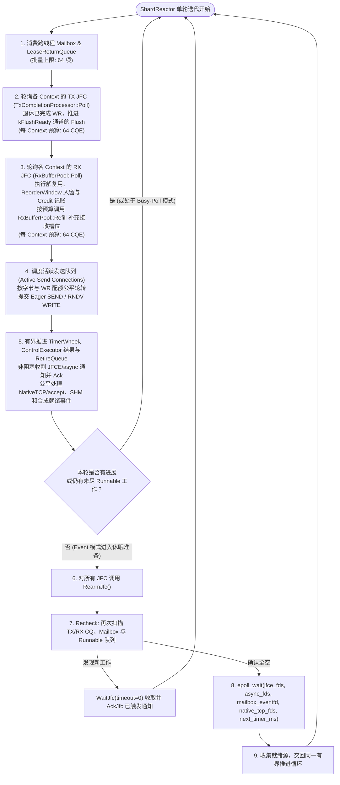

预算覆盖整轮及每个内层操作，耗尽时保存 runnable continuation 并轮换，不能通过 drain-to-empty 让某个 CQ、控制队列或热连接独占 Owner。Busy-Poll 和持续繁忙的 Event 模式都必须执行步骤 5；JFCE/async、原生 TCP 和 SHM 不能只在阻塞等待返回后获得服务。

接收域单独记录 `target_posted`、实际 accepted RQE 和 `refill_debt`；部分 post 只按被接受前缀增加 posted。暂时容量不足或无空闲 Lease 时保留补投责任，由 LeaseReturn/资源恢复通知或本 Owner 的重试 timer 驱动，确保没有新 CQE 时仍可恢复。Mailbox、LeaseReturn、控制完成和 SHM 发布须使用经过验证的发布/通知/recheck 协议唤醒休眠 Owner，不能仅凭一次 empty→nonempty 判断省略通知。

### 9.2 硬件事件与水线处理的严格规范（M3 核心规范）

1. **JFCE 通知与 CQE 分开记账**：
   - 硬件契约（**H11**）保证 `RearmJfc` 时若已有 CQE 仍会触发通知，但仍必须保留步骤 7 的 `Recheck`。
   - 无论因 `epoll_wait` 唤醒还是因 `Recheck` 跳过睡眠，只要 `WaitJfc` 取出了通知计数 $k$，都必须对该 `JFC` 执行 `AckJfc(jfc, k)`，防止未确认通知引用泄漏导致后续销毁失败。
   - 每个 context 的 async fd 由明确的单 Owner 有界消费。`GetAsyncEvent` 后先校验对象所属 context/代次并复制所需事件语义，再 `AckAsyncEvent`；Ack 后不得继续借用原事件存储。JFCE 通知、async 引用和软件回调均纳入第 5 节的销毁/ID 复用屏障。
2. **`JFR_LIMIT` 水线事件重使能（基于 H10）**：
   - 收到并校验 `URMA_EVENT_JFR_LIMIT` 后，复制所属域信息并以 `AckAsyncEvent` 确认事件；
   - 由于触发后硬件 `rx_threshold` 已自动清零，接收域必须先执行 `RxBufferPool::Refill` 将 `posted()` 补充至高于阈值（如 $> 64$），然后**显式调用 `UrmaApi::ModifyJfr` 重新写入 `rx_threshold = 64`**。若当前因无空闲 Lease 暂无法补过水线，则置位 `refill_debt` 与 `watermark_rearm_pending`，待后续 Lease 归还补槽达标后再重写水线。
3. **`JFC_ERR` 异步错误处理**：
   - 一旦捕获并校验 `JFC_ERR`，立即封禁依赖该 JFC 的队列、记录和连接的新预留/投递，按有界批次分发致命错误；将未取得终结证据的 Attempt、RX 内存及其完整资源依赖转入 `QuarantineLedger` 保留至有明确安全边界或进程退出。独立健康 JFC 域可继续推进，不能因为其他 Jetty 查询 READY 就忽略其对故障 CQ 的依赖。此为保守故障门禁，故障 CQ 的完整恢复/回收仍延期，不宣称已具备安全在线重建能力。

---

## 10. 异步建链、故障探测与 POSIX/P2300 接口层

### 10.1 非阻塞建链与能力协商状态机

**当前实现 M5.1–M5.3.4**：`HandshakeChannel` 接管宿主已连接的非阻塞协议 fd；`ConnectionHandshake` 对接 M4 接收窗口/授信账本与 `ConnectionTable`，等待 `EndpointImportCache` 的控制线程结果后先发布路由、再发送 READY。HELLO 提前广告本端接收授信 epoch，READY 重复确认；入站 CREDIT 使用对端 epoch，本地物理 RX 消耗使用本地账本，两者独立。双方 READY 且本端 READY 写尽后才激活；对端 READY 后停止握手读取，保留后续字节。有界 Connection、NativeTCP connect/listen/backend 与 Runtime owner 接线已交付。控制协议 v3 的 HELLO 交换最多 64 条主动 Lane 的物理身份与代次，完整 Connection 在来源原子登记前禁止 READY；在线 UPDATE/ACK 由宿主显式启用并逐份授权，健康连接等待新来源安装确认后才恢复投递。失败连接不因此复活，旧来源继续保留，ACK 不代表 DMA 终结或远端静默。M5.3.4 的 `ConnectionOwner` 已拥有固定容量的连接对象和来源适配器，提供带代次句柄的 fd 接管、准备、收发和分阶段关闭入口；自动拓扑及 raw 物理资源装配仍未交付，以下状态图保留完整目标。组件约束见 [建链组件](../connection-handshake.md)及[连接 Runtime](../connection-runtime.md)。

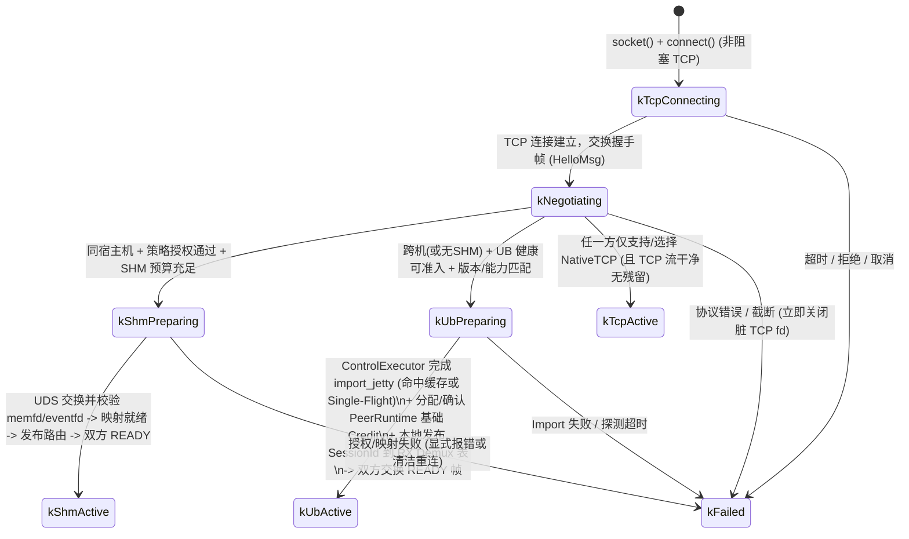

**40k/s 建链吞吐保障机制**：
1. **物理资源零热建**：`UrmaContext`、`JettyPool`（含被动 `rx_target_jetty` 与主动 `tx_lanes`）、`RxBufferPool` 和基础注册内存均在 `KbRuntime::Initialize` 时预建完毕，单次 `connect`/`accept` **零硬件队列创建、零 MR 注册**。
2. **`EndpointImportCache` 与 Single-Flight**：缓存键至少包含 `{local_context_incarnation, peer_runtime_instance, peer_eid, rx_jetty_id, domain_gen, transport_mode, authorization_identity}`，禁止跨本地 Context 复用导入句柄，或在远端重启后命中旧 ID。首次导入通过 Single-Flight 合并，后续同身份连接共享受控引用；entry 数、导入并发及等待队列有硬上限。失效条目停止新借用，但在途 WR/控制任务持有的旧句柄须等依赖终结后再 unimport，不能因缓存过期直接销毁。
3. **路由先于 READY 发布**：接收端必须在将 `SessionId -> Connection*` 写入分片路由表并准备好初始 Credit 后，才能向对端发送最终 `READY` 确认帧，彻底杜绝首包先于路由表到达而被丢弃（吸收 `aa6049a5` 教训）。

**协商与降级边界**：NativeTCP 兼容模式不能向任意未识别的普通 TCP 服务发送私有 HELLO 并消耗业务字节；须通过显式配置、独立控制通道或约定的协议入口确认对端能力。握手失败后的脏 TCP fd 必须关闭，只有未污染业务流或新建干净连接时才可选择 NativeTCP。UB/SHM 激活后的连接错误显式失败，不迁移旧字节流；Secondary 路径只用于新连接选择，不恢复旧 Session。

### 10.2 故障分类、健康注册表（`HealthRegistry`）与有限探测

| 故障信号 | 故障归因作用域 | 健康表与重连决策 |
| :--- | :--- | :--- |
| **`status 8` (`REM_ACCESS_ABORT_ERR`)** | 远端特定 `(PeerRuntimeId, ReceiveDomainId)` | 终结当前连接；标记该远端 `EndpointImportCache` 条目需重验，**不拉黑本端物理设备或端口** |
| **`status 10` (`RNR_RETRY_CNT_EXC_ERR`)** | 当前连接 / 远端接收域瞬时拥塞 | 终结当前连接并告警授信异常；**不拉黑本端 Lane 或物理路径** |
| **`status 9` (`ACK_TIMEOUT_ERR`)** | 1. 触发错误的本地 `tx_lane`（立即排空重建）； 2. 累计记录 `(local_ctx, peer_eid)` 路径异常计数 | 单次 `status 9` 先重建本地 `tx_lane`；若短窗口内向同一 `peer_eid` 或同一 `local_ctx` 连续触发 `status 9`，将该路径转入 `COOLDOWN(60s)` |
| **`JFC_ERR` / 本地 Context 级硬件错误** | JFC_ERR 影响关联依赖域；Context 级错误影响整个 Context | 关闭受影响资源域准入，独立健康队列按已验证边界继续服务；所有可用 UB 域均不可准入时，新连接选择 NativeTCP |

- **冷却与 Single-Flight 真实数据面探测**：路径进入 `COOLDOWN`（默认初始 60s，支持指数退避与 Jitter）期间，新连接优先选择剩余健康 Context 或直接走 `NativeTCP`。冷却到期后进入 `PROBING` 状态，**仅放行 1 个探测令牌（Single-Flight）**，且必须完成真实 `RM_CTP` 握手与首包收发才恢复为 `HEALTHY`，防止 40k 连接在冷却到期瞬间产生建链风暴。

### 10.3 接口分层：C ABI、POSIX 兼容与 C++23 P2300

1. **内部 C++ 核心接口**：遵循 `AGENTS.md` 第 4 节，所有可失败接口统一返回 `std::expected<T, Error>`（无返回值使用 `std::expected<void, Error>`），`Error` 不含 `kOk`，快路径零动态分配。
2. **显式 C ABI（`kbsocket/api/kbsocket.h`, `buffer.h`）**：提供句柄式非阻塞连接、普通读写及零拷贝 `kb_alloc_lease` / `kb_write_lease` / `kb_read_lease` / `kb_release_lease`。
3. **POSIX Socket & Epoll 兼容层（`kbsocket/socket/`）**：支持 `socket`/`connect`/`accept`/`read`/`write`/`readv`/`writev`/`close`/`shutdown`/`getsockopt(SO_ERROR)` 及 `epoll`（`EPOLLIN`/`EPOLLOUT`/`EPOLLET`/`EPOLLONESHOT`）。内部合成事件与原生内核 `epoll` 共享公平配额，防止加速连接事件饿死原生 TCP `accept`。
4. **C++23 项目中的 P2300 风格异步层**：通过适配实现 sender/receiver，不把 P2300 的标准库实现当作 C++23 已有能力。基于 Operation State 封装 `AsyncConnect`/`AsyncRead`/`AsyncWrite`，正常、错误、超时与取消竞争下恰好完成一次；错误通知和 `source_reusable` 分开，DMA 未终结前不归还借用内存。

普通读写支持部分完成、`EAGAIN`、双向独立关闭与 `SO_ERROR`。可读 readiness 来自连续可读字节或可报告的 FIN/错误；可写 readiness 由连接状态及本地能否接纳新的写入决定。远端 credit 暂缺限制物理提交，但不应遮蔽仍有 staging 容量可接收的普通复制写。非 owner 线程调用普通 `write` 时，必须在返回前复制已接受字节，或等 owner 完成该复制后返回；不能只把用户指针入 Mailbox 就宣告成功。

---

## 11. 同宿主机授权共享内存后端（`ShmBackend`）

同宿主机容器间通信无需占用宝贵的 UB 硬件队列（`Jetty`/`JFR`）与 NIC 注册内存（MR），亦无需承担设备 Doorbell/CQE 开销。

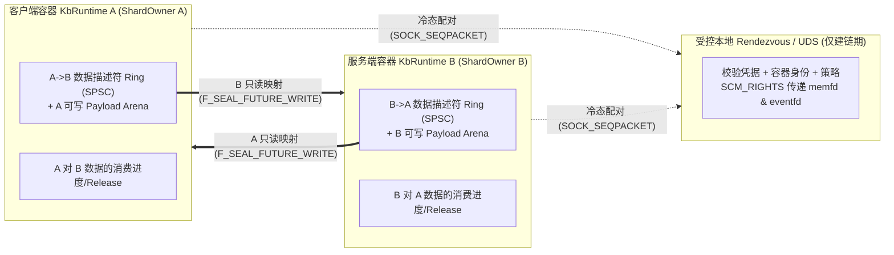

### 11.1 安全与内存隔离设计

1. **适用门禁**：仅在验证为同一宿主机、通过受保护 Pathname `AF_UNIX`（`SOCK_SEQPACKET`）完成身份与租户策略校验、且 SHM 预算充足时启用。已确认同机但不满足 SHM 条件时按策略使用 NativeTCP，不为该连接单独创建 UB 资源；跨机或尚未确认同机时遵循 §10.1 的 UB/NativeTCP 协商流程。仅提供 SHM/NativeTCP 的 Runtime 可按需启动，不强制初始化 UB。
2. **`RuntimePair` 复用与单写者封印（File Seals）**：
   - 资源按 `{LocalRuntimeId, PeerRuntimeId}` 建立单条 `ShmPair`，该对进程间的多条逻辑 Socket 复用同一 `ShmPair`。
   - 采用 `memfd_create(MFD_CLOEXEC | MFD_ALLOW_SEALING)` 创建定长共享区，设置 `F_SEAL_SHRINK | F_SEAL_GROW`。
   - **读写分离防篡改**：A 端创建的发送区由 A 建立 `PROT_READ | PROT_WRITE` 映射后，立即施加 **`F_SEAL_FUTURE_WRITE`**，再通过 `SCM_RIGHTS` 将 FD 传给 B 端；B 端仅能建立 `PROT_READ` 只读映射。反向通道对称。
3. **跨进程无锁 SPSC Ring 与双轨反压**：
   - 生产者/消费者索引各自独占 `alignas(64)` Cacheline，使用 `std::atomic<uint64_t>`（编译期静态断言 `is_always_lock_free`）配合 `memory_order_release` / `memory_order_acquire` 发布。
   - **Descriptor 槽位与 Payload Lease 分离计账**：消费者从 Ring 取出描述符仅释放 Ring 槽位；底层共享 Payload 切片必须等接收端应用 `read` 拷贝完成或显式 `Release(lease)` 后，通过反向消费进度归还。
   - 消费索引/Release 进度写在消费者自己可写的反向控制区，不能写入对端封印后的只读区。先复制描述符到本地再校验代际、offset、length 与整数溢出，禁止重复读取可被对端改写的描述符作寻址；payload 仍可能被其原始写者修改，seals 不构成对恶意生产者的内容不可变保证。不可接受该信任边界时使用 copy 后端或 NativeTCP。
   - **崩溃与残留映射隔离**：若对端异常崩溃（由控制通道 EOF / `pidfd` 检测），立即废弃旧 `ShmPair`，在本地所有已借出视图释放前保留旧映射（计入隔离预算），重连时创建全新 `memfd` 实例。

---

## 12. 低开销可观测性架构（USDT + eBPF + 分片指标）

遵循 `AGENTS.md` 第 5 节与 [可观测性设计指南](../OBSERVABILITY-DESIGN-GUIDE.md)，V1 摒弃重度侵入数据面的进程内全量文件日志和复杂自定义采集环，采用**三层零分配可观测架构**：

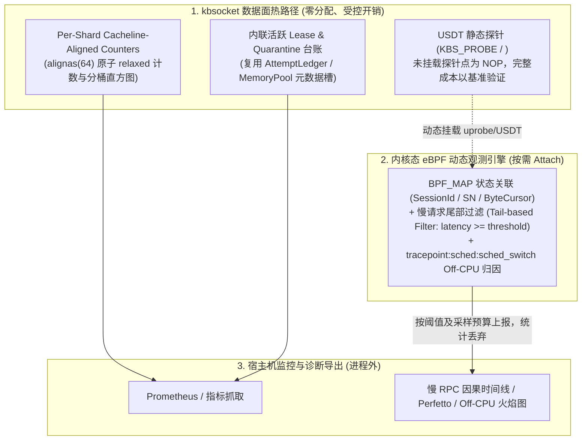

### 12.1 第一层：常驻分片轻量指标（`ShardMetrics`）

每个 `RuntimeShard` 维护独立的 `alignas(64) ShardMetrics` 结构（单写者 `memory_order_relaxed` 更新，监控线程只读快照聚合）：
- **连接与握手**：活跃连接数、每秒 `UB_ACTIVE`/`SHM_ACTIVE`/`TCP_ACTIVE` 建链数、握手失败分类、`EndpointImportCache` 命中率。
- **队列与吞吐**：每 Lane 的 `reserved`/`committed`/`retired` WR 数、`partial_post` 次数、CQE 批次均值。
- **错误与自愈**：逐状态码 CQE 计数（`status 8`、`status 9`、`status 10`、`WR_FLUSH_ERR`、`WR_UNHANDLED`）、`tx_lane` 在线重建次数、`JFC_ERR` 域隔离次数、`HealthRegistry` 冷却/探测计数。
- **流控与内存**：各接收域 `posted()`/`held()`/`available()`、`refill_debt`、基础/弹性 Credit 余额、credit 停顿次数、RNDV 在途字节，以及 **`QuarantineLedger` 隔离内存字节数与条目数**。

### 12.2 第二层：USDT 静态探针与字节游标桥梁（Byte-Cursor Bridge）

在关键阶段埋设 `<sys/sdt.h>` 静态探针。参数只传现成标量，不在探针参数中格式化、分配或做昂贵计算；分别验证未启用、启用过滤及高负载状态的开销，不把探针点的 NOP 等同于整段代码绝对零成本：
- `KBS_PROBE(kbsocket, tx_submit, conn_id, byte_begin, byte_end, flags)`
- `KBS_PROBE(kbsocket, wr_post, lane_id, lane_gen, first_attempt_id, count, accepted, status)`
- `KBS_PROBE(kbsocket, cq_tx_observed, lane_id, attempt_id, opcode, status)`
- `KBS_PROBE(kbsocket, cq_rx_observed, domain_id, conn_id, sn, len, status)`
- `KBS_PROBE(kbsocket, rx_deliver, conn_id, byte_begin, byte_end)`
- `KBS_PROBE(kbsocket, wait_begin, conn_id, wait_reason, required, available)` / `wait_end`
- `KBS_PROBE(kbsocket, lane_rebuild, pool_id, lane_idx, old_gen, new_gen, status)`

**跨层关联与硬件盲区界定**：
- 上层 RPC（如 bRPC `correlation_id`）与底层 UB 分片（`sn`）通过连接级单调递增的**累计字节游标（`byte_cursor`）**无侵入关联，无需修改线协议塞入业务 `rpc_id`。
- 鉴于当前 UB 硬件 CQE 无时间戳（**H11**），严禁将 `wr_post -> cq_tx_observed` 直接命名为纯网络耗时；统一结合 `sched_switch` 与空 CQ 锚点拆分为“线程 Off-CPU 调度等待”、“Reactor 服务其他阶段间隔”与“传输完成观察窗口（`transport_completion_observation`）”。
- 尾部过滤只能对此前已启用采集并保留在有界 BPF 状态中的事件做关联；错误发生后才 attach 不能恢复历史。Map 容量、采样率、超时淘汰和丢事件须可观测，慢请求比例也不能预设小于 1%。配套指南中的固定耗时数字须经目标平台基准验证后才能成为验收依据。

---

## 13. 正确性与故障注入验收门禁

所有核心模块在合入前必须通过无硬件依赖的 `gMock` 确定性单元测试（模拟任意 `UrmaApi` 返回码、部分接受、乱序/迟到/伪造 CQE）及双进程集成测试：

| 门禁编号 | 验证场景 | 必须成立的系统不变量 |
| :--- | :--- | :--- |
| **G1** | **残留 RX 的接收域安全关闭** | 建立远端静默与对象销毁屏障，在 provider 对象有效时解析 CQE/事件；删除所有关联 Jetty 后成功 DeleteJfr 才终结残留 Posted。Held、CPU、通知/async 引用未结清前不释放其依赖；任一步骤失败可安全重试，无双重释放 |
| **G2** | **共享 SQ 上 `status 8` 与 `status 10`（RNR）隔离** | 合法 status 8/10 不新触发整 SQ 排空；已故障 Lane 也不能因此恢复 Ready。验证受控故障注入下同 SQ 健康目标仍可推进；RNR 隔离证据来自 SEND，不虚构 WRITE 的 RNR 测试覆盖 |
| **G3** | **芯片 `status 9`（`ACK_TIMEOUT`）隔离与在线重建** | 已验明身份的 WR 报 status 9 后立即封禁 Lane，经 ERROR/边界/flush 与旧事件终结屏障后替换；仅主动 Lane 故障且共享 JFR/JFC 健康时验证被动端点保持不变。已有失败 Session 不因换 Lane 恢复，重建失败须保留依赖并可重试 |
| **G4** | **迟到/伪造 CQE 与代际门禁** | 旧 `lane_gen` 的迟到错误 CQE 或无有效 `user_ctx` 的异常边界事件，绝不能触发已重建新 Lane 的 `BeginDrain` 或释放新票据 |
| **G5** | **批量 Post 部分接受（`ENOMEM` + `bad_wr`）** | SN 在调用前确定，只有实际接受前缀标记已提交；明确未接受后缀取消本次票据并保留原 SN，后续数据不越过它；非法 bad_wr/接受未知时封禁通道并保留 DMA 依赖，不重放已接受部分 |
| **G6** | **同 SQ `SEND` 乱序与 Eager/RNDV 交错** | 乱序、重复、延迟 RNDV 占位下按连续前缀交付；发送窗口不得超过协商的 W。分别验证紧凑 4096 B 单 WR 与扩展身份/捎带头分片，40k 槽位、短代际耗尽切换及完整代际/SN 耗尽均不复用旧身份 |
| **G7** | **`WRITE RNDV` 两阶段通知与异常 `Grant` 隔离** | 全部 WRITE CQE 成功前不发送 DONE；异常 Grant 只有封禁后续写并终结全部已接受写，或取得已验证的撤权及 DMA 终结屏障后才可复用；时间、普通 UnregisterSeg 返回及本地账本归零均不得冒充该证明 |
| **G8** | **`JFR_LIMIT` 水线清零重配与守恒授信** | 水线触发后回读为 0，在补槽高于水线后显式 `ModifyJfr` 恢复通知；3000 Peer 总授信严格遵守 $F + G + U = B$ 守恒，无超卖、无控制帧死锁 |
| **G9** | **FD 快速复用与异步取消（P2300 / Socket）** | `close(fd)` 后立即复用相同整数 `fd`，旧 CQE/`epoll` 事件因 `binding_gen`/`conn_gen` 不匹配被安全丢弃；取消在途零拷贝操作时，源 `BufferLease` 保持至硬件终结后才可复用 |
| **G10** | **同机 `ShmBackend` 封印与对端崩溃** | 对端无法写入本端 `F_SEAL_FUTURE_WRITE` 共享区；对端 `SIGKILL` 崩溃后，本端检测并安全隔离旧映射，在途借用视图在 `Release` 前不发生 `SIGBUS`/Use-After-Unmap |
| **G11** | **事件公平性与补投债务** | Busy-Poll、持续热 TX、空唤醒、recheck 跳过睡眠时仍处理 async/JFCE 和 native readiness；已取得通知全部 Ack；refill 暂败且无新 CQE 时仍能重试，无进度类永久饥饿 |
| **G12** | **旧授信、控制耗尽与慢读** | close/重连不重发旧信用，旧 Session 消耗仍可归账；3000 Peer 控制突发不绕过 C 预算，双向满数据窗仍可通过控制路径推进；慢读同时受驻留字节与序号窗口限制 |
