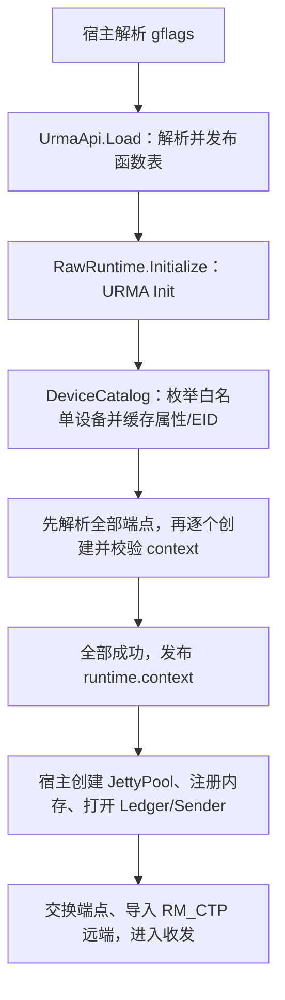

# 当前 Raw 传输流程

[文档入口](README.md)

目前已实现显式裸设备选择、context 生命周期、共享队列池，SEND/SEND_WITH_IMM 的提交和 TX 完成回收，以及 RX buffer 池。双端工具把这些组件与测试用 TCP 控制协议、内存注册和接收循环串成了硬件验证闭环。正式连接协议与 socket/epoll 接入仍未实现；RX 内存管理已进入 raw 层，工具中的控制协议和 payload 校验仍属于测试逻辑。单 SQ TX 排空及同池 SQ 故障隔离已通过用户的硬件测试；共享 JFR 带未消费接收 WR 的显式关闭尚未实现，正常收发不依赖这项能力。

## 组件与所有权

| 组件                  | 拥有的资源                                                      | 借用或引用的资源                      |
|-----------------------|-----------------------------------------------------------------|---------------------------------------|
| UrmaApi               | 动态库加载引用、唯一函数表                                      | 不接管业务硬件资源                    |
| RawRuntime            | URMA 会话、DeviceCatalog、各设备的 UrmaContext                  | 宿主已加载的库                        |
| DeviceCatalog         | 设备属性、EID/index 快照                                        | URMA 会话中的 device 指针             |
| UrmaContext           | 一个通过 EID/index 校验的 context；失败时可能保留待清理 context | 对应设备                              |
| JettyPool             | TX JFC、RX JFC、共享 JFR、多个 jetty、票据槽                    | context                               |
| AttemptLedger         | 固定容量的 attempt 记录                                         | pool、目标指针、buffer/grant 租约标识 |
| TxSender              | 最多 256 条 WR 的固定描述符数组                                 | ledger                                |
| TxCompletionProcessor | 最多 64 条 CQE 的固定轮询数组                                   | ledger 及其 pool                      |
| RxBufferPool          | 4 KiB buffer slab、注册段、接收 WR 和 lease 状态                | JettyPool 及其 context               |
| SendTestSession       | 池、账本、发送器、注册内存和远端导入等测试资源                  | runtime 提供的 context                |

RawRuntime 不包含 JettyPool，账本也不会因保存租约标识而自动管理实际内存。宿主必须使被借用的资源活到最后一次访问和 DMA 终结之后。队列、账本、post 和 poll 由同一 owner 串行推进，不允许并发或重入。

## 初始化路径

四个裸设备配置为四个 `DeviceConfig`，每项选择一个实际 `eid_index`，对应一个 context；当前没有四设备自动调度或故障迁移。目录只在初始化时查询 EID，收发路径不重复枚举。`RawRuntime::context(index)` 的 index 是配置顺序，和 provider 的 EID 索引是两回事。

`UrmaContext::Open` 成功才对外提供可用 context；实际 EID/index 不符时立即尝试删除。删除失败仍保留所有权供后续 Close，但不会通过 get 暴露该 context。初始化回滚同时保留原始错误和清理错误。

会话及退出契约见 [URMA 运行时](urma-runtime.md)，缓存边界见 [DeviceCatalog](device-catalog-reference.md)。

## 一轮双端 SEND

以下对应 [send_test.cpp](../tools/send_test/send_test.cpp) 的现有实现，不是尚未完成的正式连接层。

1. 两端准备一个 jetty、一个共享 JFR 和独立 TX/RX JFC，注册按系统页对齐的内存。工具显式将 TX/RX 深度设为 batch，TX CQ 设为 batch+1。
2. TCP 交换 EID、jetty ID 和测试参数；发送端导入对端 RM_CTP jetty。TCP 地址用于控制通信，EID 用于 UB 数据传输。
3. 接收端通过 `RxBufferPool::Refill(count)` 向 JFR 投递本轮接收 buffer，然后经 TCP 发出 READY。
4. 发送端填充 payload，`TxSender::Send` 通过账本预留整批额度，将 AttemptId 写入 WR 的 user_ctx，再 post 到同一 SQ。每条 WR 可独立指定目标；连接并不独占 jetty。
5. 发送端用 `TxCompletionProcessor::Poll` 处理 TX CQE。合法终结完成通过账本归还池额度，并返回原操作和资源引用。
6. 接收端通过 `RxBufferPool::Poll` 获得完成事件与 lease，检查长度、消息序号及 payload，归还全部 lease 后经 TCP 返回 ACK。
7. 发送端等待本轮所有 TX attempt 退休且收到远端校验 ACK，才复用 buffer 进入下一轮。最后完成控制握手并显式清理。

提交成功、TX 完成、远端 payload 校验是三个不同阶段。TX CQE 不代替远端应用确认。工具的逐批 READY/ACK 避免接收额度不足，因此不能用它推断吞吐、延迟或背压表现。

[共享队列双向工具](../tools/shared_queue_test/README.md) 在上述组件之上补充 SEND_WITH_IMM 验证：每端多个 jetty 共用 JFR/TX JFC/RX JFC，同一 SQ 逐 WR 轮换远端目标，双方同时收发，并检查 IMM 与 CQE 端点归属。它使用工具专用 payload 头，不冻结正式连接协议；仍是单 context、逐轮同步的正确性测试。

[同池 SQ 故障隔离工具](../tools/sq_isolation_test/README.md) 将共享队列与排空组合：两条 SQ 先正常收发，再将其中一条置 ERROR，另一条继续提交并收发；同时按 SQ 区分普通完成、硬件边界和软件 flush。故障流量使用独立且不投 RX 的远端 sink，正常流量只进入健康目标，避免遗留无法确定消费数量的接收 WR。它验证主动置错的物理 SQ 隔离，不代表同 SQ 内连接隔离或远端掉线后的影响范围。

[背压工具](../tools/backpressure_test/README.md) 的 `tx_quota` 模式暂停 TX poll，填满软件 SQ 配额后检查额外 WR 被拒绝，再退休完成并仅重试此前未被接受的 WR；`rx_delay` 先发送再延迟投递 RX，区分原始数据全部成功与异步错误后的终结排空。后者使用另一条 SQ 发送具有独立身份的清理消息，消费剩余 RX 槽位；清理流量不计为原始数据恢复，已接受的原始 WR 不会重放。迟到的原始 RX 可能使清理 SQ 遇到 RNR，因此清理 SQ 也支持排空，只有全部 RX 槽位和 TX attempts 归还后才能关闭资源。软件配额拒绝、provider 的同步 EAGAIN 与远端缺 RX 的异步结果分别统计；provider EAGAIN 非零不是通过条件。

`rnr_continue` 模式在首批 WR 全部返回 RNR 后才补投 RX，再用同一条 SQ 发送新消息。它在工具内消费完成并查询硬件状态，验证期间不调用 modify ERROR 或 flush，也不创建替代 SQ；用于区分 WR 终结错误与 SQ 不可用。用户已反馈 `rnr_continue_success`，表明本次硬件与配置下同一条 SQ 在 RNR 后仍可成功发送新消息；生产完成层的主动排空策略保持不变。

[同 SQ 多目标工具](../tools/sq_multiplex_test/README.md) 在一条 SQ 的同一次 post 中交替选择健康与缺 RX 的目标，两者使用独立 JFR。每轮对照混合流量前后的正常发送，逐条检查健康 SUCCESS、sink RNR、远端 payload 和同一 SQ 的 READY 状态，并记录软件消费 CQE 的顺序与耗时。工具不因普通 RNR 主动排空 SQ；时序统计用于硬件观测，不能单凭 CQE 顺序判断硬件执行是否阻塞。该工具尚待真实硬件运行反馈。

发送组件之间的调用和失败处理见 [TX 数据路径](tx-pipeline.md)；接收内存及 lease 见 [RX buffer 池](rx-buffer-pool.md)；队列容量、票据和故障隔离见 [JettyPool](jetty-pool.md)。

## 退出路径

正常顺序是停止新操作、排空在途收发、关闭发送器和账本、解除远端导入、关闭 RX buffer 池并注销接收内存、关闭队列池、注销发送内存，再关闭 runtime（context → Uninit），最后 Unload。具体子资源顺序由其依赖决定，不能只看到发送器 Close 就释放 buffer。

出现无法确定接受范围、未终结 DMA 或清理失败时，必须保留依赖资源，不能强行清空账本。测试工具将这类情况判为失败；当前支持 modify ERROR、等待硬件边界、软件 flush 的单 SQ 排空，详见 [TX 故障排空](tx-pipeline.md#error-continue-与单-sq-故障排空)。不自动重放或在线恢复，接受范围不可信的 Prepared 记录仍保留。

对于不能确认 worker 已停止访问的进程退出路径，`GetRawRuntime()` 使用 NoDestructor 避免自动关闭 context。池、账本、注册内存和目标等关联资源也必须保持存活；仅让 runtime 常驻并不足够。显式 Close 仍要求调用方先完成停止和排空协议。

## 已验证范围

以下均来自用户的真实硬件运行反馈，本地未重复进行硬件测试。具体参数、计数、证据来源和结论边界统一记录在 [硬件观测记录](hardware-observations.md)。

| 场景 | 已确认的行为 |
| --- | --- |
| 基础 SEND 与 RxBufferPool | 三组配置通过，覆盖完整 payload 校验、批次复用与正常关闭 |
| 共享队列 SEND_WITH_IMM | 单 SQ、双 SQ、四 SQ 配置通过，覆盖共享 JFR/JFC、逐 WR 目标切换及双向完成归属 |
| 独立 TX 排空 | 已接受 WR 全部退休，收到硬件边界，ERROR SQ 被本地门禁拒绝新发送，两端正常关闭 |
| 同池 SQ 故障隔离 | 非零 FLUSH_ERR，故障 SQ 排空期间健康 SQ 和共享 RX 保持可用 |
| TX 配额与延迟 RX | 配额测试通过；延迟 RX 观察到原始 WR 全部 RNR，再由另一条 SQ 的独立清理流量消费 RX 槽 |
| 同 SQ 的 RNR 后续发 | 用户反馈 `rnr_continue_success`；原始 WR RNR 终结后，未切 ERROR 或重建的同一条 SQ 成功发送新消息 |

尚未验证延迟 RX 后原始流量全部成功、多设备或独立 peer 并行、持续无批间屏障收发、EAGAIN 到 EPOLLOUT 唤醒、非零软件 flush、异步事件及带未消费 WR 的共享 JFR 关闭。RNR 后续发成功不能推广到其他错误，也不代表原始消息被重放或恢复。单元测试中的故障注入用于验证代码契约，不能替代硬件专项测试。
