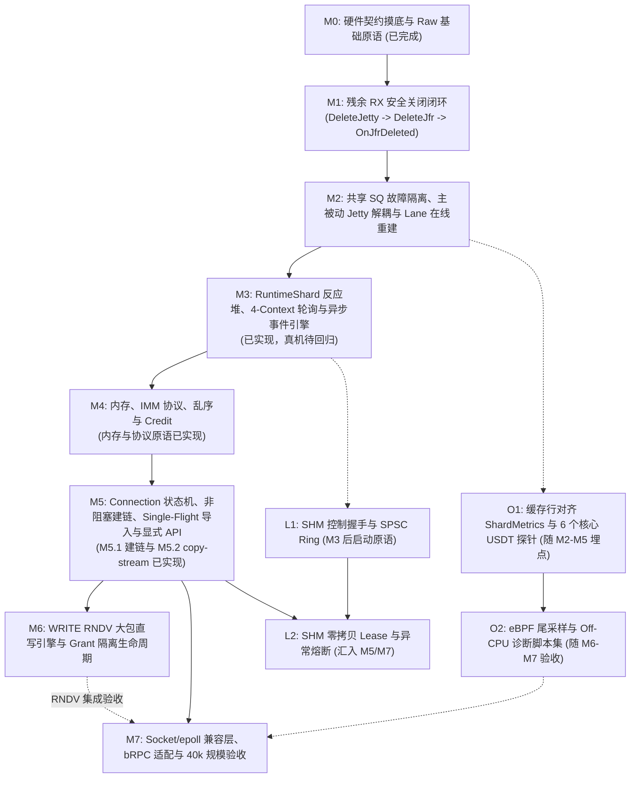

# kbsocket 演进路线图 (Roadmap)

> **对齐规范**：[kbsocket-design-v1.md](design/kbsocket-design-v1.md) · [hardware-observations.md](hardware-observations.md) · [hardware-validation-matrix.md](hardware-validation-matrix.md) · [OBSERVABILITY-DESIGN-GUIDE.md](OBSERVABILITY-DESIGN-GUIDE.md)
> **最后更新**：2026-11-07

本文档将 [kbsocket-design-v1.md](design/kbsocket-design-v1.md) 的架构拆解为可执行的里程碑、代码落点与验收门禁。M0 为文档契约及已有 raw 基础；M1 已交付 raw 关闭协调器，M2 已实现主被动 Jetty 分离、Lane 替换、完成身份校验和 WRITE 提交原语；M3 已实现借用 raw 资源的单 owner 进度器、四 context 调度、事件与有界控制执行器，验证状态分别见对应小节。M4 已交付 M4.1 固定 Slab/Lease 和 M4.2 协议、顺序、授信原语；M5.1 已交付已连接协议 fd 上的非阻塞握手、完整身份路由和 Single-Flight 导入。M5.2 已接通有界 Eager Connection copy-stream 与 NativeTCP 数据后端；M5.3.1 已接通借用资源的 Runtime owner、context 暂停组、连接 fd 调度和实际 CQE 来源登记校验；自动资源装配、主动 Lane 交换、显式 C ABI/零拷贝 API 与远端关闭协议仍待后续，Grant 联动待 M6。M6–M7、L1/L2、O1/O2 仍为待交付计划，未实现类、接口和测试路径是拟议落点。无 UB 真机时先完成 Mock 与 NativeTCP/SHM 双进程验证，真机回归明确保持未执行。

---

## 1. 现状盘点 (Baseline Audit)

### 1.1 已落地的核心模块

| 模块 | 代码路径 | 已完成能力 | 遗留差距（待后续里程碑收口） |
| :--- | :--- | :--- | :--- |
| **错误与基础原语** | `kbsocket/base/` `kbsocket/transport/raw/*_error.hpp` 及各组件头文件 | 已有日志、RAII 工具及基于 `std::expected` 的组件错误类型 | 尚无统一 `base/error.hpp`；统一应用层错误、控制面分类及 C ABI 映射时保留数据路径零分配，不新增自定义 expected 容器 |
| **动态加载与拓扑发现** | `kbsocket/transport/raw/urma_api.*` `device_catalog.*` `urma_context.*` `raw_runtime.*` | `liburma.so` 符号表加载、设备枚举、`RM_CTP` 能力校验、多 `UrmaContext` 初始化；M3 可显式绑定已创建的 context | 自动拓扑分片、资源创建与 NUMA 亲和性调度尚未接入 |
| **池化 Jetty 管理** | `kbsocket/transport/raw/jetty_pool.*` `receive_domain_closer.*` | 共享 `JFR`、固定被动接收端点与主动 TX Lanes；Round-Robin、ERROR/边界/flush 排空、接收域分阶段关闭；M2 新增 Lane generation 与显式 `ReplaceDrainedLane`；M3 将排空修改和显式替换交给控制线程 | 关闭/替换的远端静默、旧 CQE 和事件引用屏障仍由调用方证明；M1 关闭需宿主在控制路径推进，M5 远端关闭协议待实现；不支持故障 JFC 在线恢复 |
| **TX 发送与完成收敛** | `kbsocket/transport/raw/attempt_ledger.*` `tx_sender.*` `tx_completion_processor.*` | 单调 `AttemptId`、SEND/SEND_WITH_IMM/WRITE 提交与接受前缀入账；`LookupPosted` 核验已提交记录及完整 Lane 身份后再处理错误；8/10 逐 WR 退休，9 隔离排空；M3 用 owner 回调交付结果 | M5.2 已接通 Connection 的逐 WR DMA/import 引用与完成分发；替换屏障的自动证明、WRITE Grant 与 DONE 协议仍待后续接入；不自动重试或重放已接受 WR |
| **RX 缓冲池** | `kbsocket/transport/raw/rx_buffer_pool.*` | 连续内存预分配、DMA 段注册、`Refill`/`Poll`/`Release`/`Stop`、`RxBufferLease` 借出与归还；M1 在 `DeleteJfr` 成功后内部清退残留 Posted，Held 归还后才注销内存；M3 联动补投与水线重写 | 独立 Slab 的跨线程归还已在 M4.1 实现；本池 backing 尚未迁移，RMA Grant 协议待 M6，不能由 RX 关闭代为终结 |
| **单 owner 运行时进度** | `kbsocket/runtime/` | `RuntimeShard` 绑定最多四 context，`ShardReactor` 分类公平预算与事件等待，`RawContextProgress` 做通知/async 归属及错误隔离，`ControlExecutor` 执行慢控制任务 | 借用已有 raw 对象；不创建完整连接/runtime 资源，不实现通用业务 mailbox、Grant 或远端关闭协议；M4.1 已接入 CPU Lease 归还 hooks；接入约束见 [RuntimeShard](runtime-shard.md) |
| **注册内存与 Lease** | `kbsocket/memory/` | 固定 Slab 最多四 context 注册、共享 backing 硬预算、独立 CPU/DMA/Grant 责任及每槽隔离记录；MPSC 归还队列与 Shard mailbox 预算集成 | M5.2 已支持有界 copy write/短写；完整 MemoryManager、RX backing 迁移和远端 Grant 协议待实现；见 [内存与 Lease](memory-leases.md) |
| **连接协议基础** | `kbsocket/connection/` | 短/扩展身份 wire codec、单调连接 token、发送累计窗口、ReorderWindow 和应用 receipt、PeerRuntime 数据/控制 Credit F/G/U 总账、ConnectionTable 完整身份路由 | M5.2 已接通借用资源的 Connection copy-stream、真实 RX receipt/refill 与累计 Credit；M5.3.1 已接通实际来源登记校验与 owner 调度；自动资源装配、主动 Lane 交换和跨 Peer 弹性授信调度待后续；RNDV 线格式保留待 M6；见 [连接协议原语](connection-primitives.md) |
| **连接建立** | `kbsocket/control/` | 已连接非阻塞 fd 上 HELLO/READY、先发布路由再 READY、双方 READY 激活、异步 Single-Flight endpoint 导入及引用保留 | M5.2 已有 NativeTCP 非阻塞 connect/listen/accept 与字节流；M5.3.1 已接入 Runtime 调度和 context 暂停屏障；自动拓扑选择与完整应用 ABI 待实现，宿主仍提供可信来源/ABI 及真实初始授信；见 [建链组件](connection-handshake.md) |
| **硬件实测工具集** | `tools/*_test` | 已记录 SEND/SGE、RMA、故障隔离、补投及多 context 通知等观测，另有人工确认的大小/生命周期/可见性契约 | 人工契约不等于测试 PASS；WN1–WN4 通知回归尚无真机日志，历史 ACK_TIMEOUT 根因仍待定位；按验证矩阵逐项回归 |

### 1.2 待建设模块（包括未创建目录与工作区接口草稿）

- `kbsocket/memory/` 后续集成：多 Slab 扩容管理、RX backing 迁移和连接/Grant 绑定；M4.1 的固定 Slab 与跨线程归还原语已落地
- `kbsocket/runtime/` 后续集成：自动资源创建、NUMA 亲和性、通用业务 mailbox/连接定时器；当前已有有界 `ProgressSource` 接口及 CPU Lease 归还源
- `kbsocket/control/` 后续集成：控制 fd 的 Reactor 调度、拓扑/身份策略与 `HealthRegistry`；M5.1 已有握手协调器及 `EndpointImportCache`
- `kbsocket/connection/` 后续集成：Runtime 级收发调度/实际来源路由及 `WriteRndvEngine`；M5.2 已交付有界 Connection copy-stream，详见 [Eager 接线](eager-connection.md)
- `kbsocket/api/` 与 `kbsocket/socket/`：`kbsocket.h`、`buffer.h`、C++23 `execution` 封装、`FdTable`、`SocketAdapter`、`EpollMux`
- `kbsocket/transport/tcp/` 后续集成与 `kbsocket/transport/shm/`：NativeTCP 的 Runtime/ABI 接线、`ShmBackend`
- `kbsocket/observability/` 与 `adapters/brpc/`：缓存行对齐 `ShardMetrics`、USDT 探针、bRPC 零拷贝适配器

---

## 2. 里程碑总览与依赖拓扑

---

M6 保留为 WRITE RNDV 阶段，M7 为规模与适配阶段；M5 后可并行，基础 Eager/NativeTCP 的规模测试不等待 RNDV。L1 可先做授权、Ring 和通知原语，完整 SHM backend/Lease 集成依赖 M4/M5。

## 3. 核心主线里程碑 (`M1` – `M7`)

### M1：残余 RX 安全关闭闭环 (`RxBufferPool` + `JettyPool`)

- **当前交付**：已实现 `ReceiveDomainCloser` 与配套 Mock 用例；2026-11-07 运行 `bazel test //kbsocket/transport/raw:all --test_output=errors`，9 个测试目标、130 个用例通过，其中关闭协调器包含 22 个用例。UB 真机回归未执行。这里只交付可显式驱动的 raw 控制原语；M3 已有 `ControlExecutor` 与事件消费，但不会自动取得关闭证明或驱动域销毁，宿主仍须在控制路径推进，M5 的远端关闭协议尚未实现。
- **目标**：扩展 `RxBufferPool` 与接收域关闭协调器，支持残留 Posted 在取得 DMA 终结证明后安全结账，落地 `H9` 硬件契约（`DeleteJfr` 可直接销毁未消费的 `kPosted` WR，无需 `ModifyJfr(ERROR)` 排空）。
- **设计章节**：[§5.3 接收域安全关闭状态机](design/kbsocket-design-v1.md#53-接收域安全关闭状态机m1-核心规范)
- **涉及代码**：
  - `kbsocket/transport/raw/rx_buffer_pool.hpp` / `.cpp`
  - `kbsocket/transport/raw/jetty_pool.hpp` / `.cpp`
  - `kbsocket/transport/raw/receive_domain_closer.hpp` / `.cpp`
  - `kbsocket/transport/raw/receive_domain_closer_test.cpp`
  - `kbsocket/transport/raw/rx_buffer_pool_test.cpp`
  - `kbsocket/transport/raw/jetty_pool_test.cpp`
- **关键改动**：
  1. **建立接收域关闭协调器**：先停止本地新准入/提交，在协调确认远端停止向该域发送之前继续 RX 消费、Lease 归还和补投，避免关闭握手期间人为制造 RNR；确认远端静默后才不可逆地停止补投。期间继续 TX 排空与通知确认。失联或空 CQ 不等于远端静默，无法建立销毁屏障时保留依赖；解除当前 RX owner 与 pool 互相等待的关闭依赖。M2 拓扑下依次逆序删除主动 Jetty、删除固定被动端点，再删除共享 `JFR`。
  2. **新增 `RxBufferPool::OnJfrDeleted()`**：当底层 `DeleteJfr` 成功后调用该接口，将残留 `kPosted` 标记为 DMA 已终结并逐条结账；关闭域不再投递这些槽位，也不伪造成功 RX。此操作不撤销 `Held`、CPU 引用或独立 RMA Grant。
  3. **两阶段 `Close()` 校验**：
     - 若 `jfr_deleted_ == false` 且 `posted_ > 0`，`Close()` 拒绝注销 `segment_`（防止硬件仍在 DMA 写入时解除页表映射）；
     - 若 `held_ > 0`，保持关闭待完成；在全部 Held、CPU 引用、通知/async 引用及其他访问责任终结后，由 owner 推进 `UnregisterSeg` 与 backing 释放。
     - provider 仍可能解析队列地址的 CQE/事件必须在对象有效时处理。删除/注销失败保留依赖，从已完成阶段重试，不能强制清零或重复回收。
- **验收门禁**：
  - 单元测试覆盖：① 通过 `Refill()` 补满 RX、对端未发送业务数据时建立静默与销毁屏障，再走 `JettyPool` + `RxBufferPool` 残留 Posted 关闭流程，验证零内存泄漏与零悬垂注销；② 存在未归还 `RxBufferLease` (`held_ > 0`) 时调用 `Close()`，验证 `UnregisterSeg` 延迟至最后一个 Lease 经 `Release` 归还且其他引用结清后触发；③ `DeleteJetty`/`DeleteJfr`/注销失败后可重试且无提前释放；④ 晚到 CQE、通知引用、无法证明远端静默、最后一个残留 RX、空闲与正常关闭均安全。

**调用边界**：由唯一 owner 调用 `Begin(pool, buffers)` 冻结 TX 准入，再以预分配的 `RxBufferEvent` 数组调用 `Advance(quiescence, events)`。在 `peer_stopped` 首次确认前，RX `Poll` / `Release` / `Refill` 继续可用；首次确认后 `Advance` 才调用 `Stop`，不再恢复补投，该静默条件须保持至关闭完成。调用方继续推进 TX 逐 WR 退休、处理每次返回的 RX 事件并归还 lease；协调器不会代替连接层消费业务数据，也不推测完成。`ReceiveDomainQuiescence` 的 `peer_stopped`、`events_acked`、`queue_users_stopped` 和 `completion_queues_healthy` 均默认 false，须由调用方根据各自责任确认。关闭期间的直接 `JettyPool::Close()` / `RxBufferPool::Close()` 不能绕过协调器；进入删除阶段后不再 poll，失败只从保留阶段重试。具体状态、provider 适用范围与屏障责任见设计 §5.3。

---

### M2：共享 SQ 故障隔离、主被动 Jetty 解耦与 Lane 在线重建

- **当前交付**：已实现以下 raw 原语与对应 Mock 用例；2026-11-07 运行 `bazel test //kbsocket/transport/raw:all //tools/... --test_output=errors`，33 个测试目标、599 个用例通过（raw 核心 154 个、工具 445 个），UB 真机回归未执行。`ReplaceDrainedLane` 由调用方显式触发，旧事件/引用屏障也由调用方证明；M3 已接入进度器与 `ControlExecutor`，M5 Connection、M6 WRITE RNDV 仍未实现。
- **目标**：根据逐 WR 错误、status 9 与共享队列的硬件契约，完成 `JettyPool`、`AttemptLedger`、`TxSender` 与 `TxCompletionProcessor` 的生产级加固。
- **设计章节**：[§5 Raw URMA 资源池与故障处理](design/kbsocket-design-v1.md#5-raw-urma-资源池收发-jetty-解耦与故障自愈)、[§7.4 WRITE RNDV 状态机](design/kbsocket-design-v1.md#74-write-rndv-完整状态机与安全终结)
- **涉及代码**：
  - `kbsocket/transport/raw/jetty_pool.hpp` / `.cpp`
  - `kbsocket/transport/raw/attempt_ledger.hpp`
  - `kbsocket/transport/raw/tx_sender.hpp` / `.cpp`
  - `kbsocket/transport/raw/tx_completion_processor.hpp` / `.cpp`
  - `kbsocket/transport/raw/jetty_pool_test.cpp`
  - `kbsocket/transport/raw/attempt_ledger_test.cpp`
  - `kbsocket/transport/raw/tx_sender_test.cpp`
  - `kbsocket/transport/raw/tx_completion_processor_test.cpp`
- **关键改动**：
  1. **主被动 Jetty 角色解耦**：
     - 在 `JettyPool` 中创建 1 个被动 `rx_target_jetty`（绑定共享 `JFR` 与 `RX JFC`，永不投递 TX WR），通过 `JettyPool::rx_target_jetty_id()` 对外暴露，供对端 `ImportJetty` 使用；
     - `JettyPoolConfig::jetty_count` 只计主动 TX Lanes；实际创建数量为 `jetty_count + 1`，能力校验包含被动端点。被动 JFS 请求深度为 1，不向其提交 TX；TX CQ 至少为 `jetty_count * (tx_depth + 1) + 1`，最后一项预留被动端点边界。
     - 被动端点先创建；全域关闭时先逆序删除主动 Lane，再删除被动端点和 JFR。`IsReceiveJetty` 接受固定端点及当前有效主动 Jetty，兼容旧工具目标；生产对端应只导入固定被动端点。
  2. **Per-Lane 代次 (`lane_generation`) 与真实 WR 身份校验前置**：
     - 保留现有 pool epoch 和单调 `AttemptId`，`JettyLane::generation` 初代为 1；单 Lane 替换不改变其他 Lane 票据，epoch/generation/票据序号耗尽均拒绝回绕复用；
     - 真实 WR CQE 通过 `ledger_.LookupPosted(cr.user_ctx)` 取得已 Commit 记录，核对 pool、index、epoch、generation 后才允许改变 Lane 状态；未知、重复、未提交或错 Lane CQE 不得触发排空。无可信 `user_ctx` 的 `FLUSH_ERR_DONE` 等边界事件单独处理，不能当作普通 WR 查询/退休。
     - 硬件 ID 复用前建立旧对象、CQE 与异步事件终结屏障；不能凭软件 generation 推断无代次边界属于新对象，无法证明则隔离。
  3. **精细化 TX 错误分级处理**：
     - `URMA_CR_REM_ACCESS_ABORT_ERR (8)` 与 `URMA_CR_RNR_RETRY_CNT_EXC_ERR (10)`：**不调用 `BeginDrain`**，仅按可信完成调用 `ledger_.Complete` 退休该 WR 并将原始错误交给所属操作/连接；status 8 不一律解释为进程退出；同一 `tx_lane` 上的其他连接继续正常收发；
     - `URMA_CR_ACK_TIMEOUT_ERR (9)` 与本地致命错误：关闭准入，调用 `BeginDrain(lane)`/`ModifyJetty(ERROR)`；继续普通 JFC 退休真实完成与 `FLUSH_ERR`，取得 `FLUSH_ERR_DONE` 后以 `FlushJetty` 回收 `WR_UNHANDLED`，全部已接受 WR 恰好终结且边界处理完成后才可重建。
  4. **单条 `tx_lane` 在线重建 (`ReplaceDrainedLane`)**：
     - `ReplaceDrainedLane(old_lane, quiescence)` 要求该 Lane 为 `kDrained`、票据归零，且 `JettyLaneQuiescence` 的 `events_acked`、`queue_users_stopped`、`completions_drained` 全部成立；先进入 `kReplacing` 并撤销旧 ID 路由，再删除旧对象、按 Open 参数快照创建新对象，成功后才递增 generation 并恢复准入。
     - 删除失败保留旧句柄，创建失败保留空槽；两者都维持 `kReplacing` 与旧 generation，仅允许持匹配旧 Lane 和完整证明显式重试。成功阶段不重复删除；共享 JFC 仍服务健康 Lane，证明必须覆盖旧对象的全部 CQE、async 和软件引用。全域关闭开始后禁止替换；关闭可以继续销毁 `kReplacing` 的剩余句柄，不创建新对象。
     - 重建过程完全局部化，被动 `rx_target_jetty` 的 `jetty_id` 保持不变，健康连接无需仅因本地 TX Lane 替换重新 `ImportJetty`；已失败的旧连接仍显式失败，不自动续用或重放。若被动端点/接收域自身更换，必须重新发布代次并协商新连接。
  5. **`TxSender` 扩展 `URMA_OPC_WRITE` 支持**：
     - `TxSendRequest::remote` 为 WRITE 指定唯一远端 SGE，远端长度等于本地 SGE 总长；校验注册段、context 和导出 VA 区间，本地 SGE 数量受池创建配置限制，总长不超过 `min(200 MiB, max_write_size)`。全 signal、非 inline，保持部分接受前缀、接受未知及 Lease 引用规则。
     - `Send` 可混合 SEND/SEND_WITH_IMM/WRITE，但混批不建立 WRITE 与通知的可见性依赖；调用方须等全部相关 WRITE 成功退休后再发通知。当前不自动发送 DONE，不管理完整 Grant/RNDV 生命周期。
     - 可能阻塞的创建/删除先提供可显式驱动的控制原语，M3 接入 `ControlExecutor`，不进入数据面热循环。
- **验收门禁**：
  - 单测验证：① `status 10` (`RNR`) 与 `status 8` 注入时，同 Lane 旁路连接的 WR 继续 `SUCCESS (0)` 完成，Lane 保持可提交；② status 9 的普通完成、错误边界、软件 flush、删除/创建失败重试闭环；③ 旧/重复 WR CQE、无代次边界与硬件 ID 复用不能影响新 Lane；④ 健康 Lane 及被动端点保持可用，错误/关闭竞争和代次耗尽有明确结果。

---

### M3：`RuntimeShard` 反应堆、4-Context 轮询与异步事件引擎

- **当前交付**：已实现 `RuntimeShard`、`RawContextProgress`、`ShardReactor` 和 `ControlExecutor`，接入已有 raw 资源的轮询、通知、async、水线重写及故障 Lane 控制进度。2026-11-07 运行 `bazel test //kbsocket/runtime:all //kbsocket/transport/raw:all //tools/... --test_output=errors`，37 个测试目标、657 个用例通过（runtime 48、raw 164、工具 445）；UB 真机回归未执行。使用与生命周期约束见 [RuntimeShard](runtime-shard.md)。
- **范围**：单 owner 绑定 1–4 个已创建的 context，每 context 最多 8 个接收域、每域最多 64 条主动 Lane；进程内 async 消费者登记表最多 64 个 context。M3 不创建完整 runtime/连接资源，不实现 Connection、Grant、授信或 mailbox 队列，保留有界 `ProgressSource` hooks 供后续阶段接入。
- **设计章节**：[§3.3 单 Owner 与控制执行器](design/kbsocket-design-v1.md#33-并发模型单-owner-完整资源闭环)、[§9 统一进度器](design/kbsocket-design-v1.md#9-统一进度器shardreactorbusy-poll-与事件模式)
- **涉及代码**：
  - `kbsocket/runtime/runtime_shard.hpp` / `.cpp`
  - `kbsocket/runtime/shard_reactor.hpp` / `.cpp`
  - `kbsocket/runtime/raw_context_progress.hpp` / `.cpp`
  - `kbsocket/runtime/control_executor.hpp` / `.cpp`
  - `kbsocket/runtime/progress_source.hpp`
  - `kbsocket/runtime/*_test.cpp`
- **关键改动**：
  1. **4-Context 有界公平轮询**：同 owner 管理两个裸设备各两 EID 的四 context；每源、每进度类有独立预算，Tick 按 async、TX、RX、refill、flush、mailbox、timer、retire 推进并轮换起始源，预算耗尽保留 runnable。TX 完成只释放本地额度，RX 回调接收并负责归还 Lease；没有新 CQE 时仍检查补投余量及到期重试。
  2. **Busy-Poll / Event (`WaitJfc`) 双模切换**：
     - 默认纯轮询；事件模式空转超过 `busy_poll_ns` 后执行 `Poll -> Rearm -> Recheck`，仅无 runnable 工作时进入 `max_wait_ms` 限制的 `epoll_wait`。JFCE readiness、`WaitJfc` 通知和 CQE 分账，取得的每一项通知（包括重复项）都须 `AckJfc`，跳过睡眠也要收割。跨线程 `Notify` 仅唤醒，不代替 mailbox 的发布协议。
  3. **`JFAE` 异步事件处理**：
     - 每 context 唯一消费者在 async fd 可读后 Get，成功即恰好 Ack 一次；先核验 context 与对象指针再访问对应对象，不凭未知 union 指针判定故障归属；
     - `JFR_LIMIT` 后保留 `watermark_pending`，posted 严格高于配置水线才在控制线程重写 threshold；Held 未归还时保持待处理，`Release` 后继续补投与重写。已知接受前缀的 refill `EAGAIN` 采用到期重试；
     - `JFC_ERR`、`JFR_ERR`、被动端点错误及无法安全解释的 Poll/refill 失败保留整个关联域；停止该域 Poll/refill，不在线回收故障 CQ。主动 `JETTY_ERR` 先隔离所属 Lane，再由控制线程执行 `BeginDrain`，健康独立域继续推进。
  4. **有界 `ControlExecutor`**：
     - 固定 1–4 个 worker、最多 4096 个原子状态槽位，排队/执行中/完成未收割共同占容量；单 owner 提交/收割零分配、无互斥锁，满额立即 `kResourceExhausted`。已接受任务即使取消仍执行，所有结果交回 owner，不能丢弃半成品；参数依赖持有至完成收割。
     - 提交前暂停整个 raw context（含所有域与通知/async），暂移除等待 fd；控制线程执行 `ModifyJetty`、`ModifyJfr` 或显式 Lane 替换，完成收割后 owner 恢复。外部借用者也必须遵守暂停，其他 context 可继续推进。
     - `RequestReplacement` 必须显式提供 `events_acked`、`queue_users_stopped`、`completions_drained` 证明；空 CQ 不代替屏障。`RuntimeShard::Close` 只解绑：有控制任务时返回 `kInUse`，继续 Tick 收割后重试；不删除借用的 Jetty/JFR/MR，不代替 M1 关闭协议。
- **验证范围与后续门禁**：
  - Mock 覆盖四 context 公平推进、Poll/Rearm/Recheck、通知 Ack、async 归属、水线待处理及 refill 重试、控制满额/慢任务隔离、取消后收割、Open 回滚和关闭重试；没有据此新增硬件 PASS。
  - M4/M5 继续交付真实 mailbox/Lease 归还、Connection 与关闭协商；NativeTCP/SHM 双进程和真机回归分别报告实际结果，M3 hooks 的测试不代表这些协议已经实现。

---

### M4：`MemoryManager`、`IMM` 短帧/扩展帧、乱序重组与 Credit 流控

- **当前交付 M4.1**：已实现 `SlabAllocator`、共享 `MemoryBudget`、`BufferLease`/`BufferReference`、`QuarantineLedger`、`LeaseReturnQueue` 与 `LeaseReturnProgress`，使用约束见 [注册内存与 Lease](memory-leases.md)。固定 backing 最多四 context 注册；CPU、本地 DMA 与远端 Grant 分账，全部结束才复用；部分注册/注销失败保留依赖与预算。跨线程归还使用预分配 MPSC + eventfd，由 Shard 的 mailbox 预算消费。2026-11-07 运行 `bazel test //kbsocket/memory:all //kbsocket/runtime:all //kbsocket/transport/raw:all //tools/... --test_output=errors`，40 个测试目标、693 个用例通过（新增 memory 36 个）。验证使用 Mock/本机线程与 fd，UB 真机未执行。
- **当前交付 M4.2**：已实现短/扩展身份编解码及仅头部编码接口、`ConnectionTokens`、`TxSequenceWindow`、`ReorderWindow`、`SenderCreditAccount` 和 `ReceiveCreditDomain`。通过真实 Slab Lease 与模拟 DMA 的组合测试验证部分接受、乱序交付、慢读窗口、控制额度、FIN 及旧 token 拒绝；具体格式与调用顺序见 [连接协议原语](connection-primitives.md)。2026-11-07 完整回归 `bazel test //kbsocket/connection:all //kbsocket/memory:all //kbsocket/runtime:all //kbsocket/transport/raw:all //tools/... --test_output=errors`：45 个测试目标、765 个用例通过，其中 connection 新增 72 个；UB 真机回归未执行。
- **下一步 M5 集成**：接入完整 Connection、raw 接收来源/Lease/授信路由、非阻塞握手、控制调度与 Eager/NativeTCP API 闭环。当前内存仍为固定 Slab，完整 MemoryManager 扩容策略和 `RxBufferPool` backing 迁移未实现；信用账本关闭不替代 M1 队列销毁，`AttemptLedger` 和 Grant/DONE 的自动责任联动仍需连接层。RNDV 控制类型明确返回 unsupported，实际协议待 M6。
- **目标**：实现零分配数据面所需的多上下文预注册内存池、64-bit `IMM` 短帧及扩展协议帧、每连接乱序重排窗口与无死锁信用流控。
- **设计章节**：[§6 线协议与连接内顺序](design/kbsocket-design-v1.md#6-连接内顺序保留薄适配不构建重放协议)、[§7.1 内存模型](design/kbsocket-design-v1.md#71-四层内存模型与零分配快路径)、[§8 分层流控](design/kbsocket-design-v1.md#8-分层流控守恒总账长期暖窗口与大包准入)
- **涉及代码**：
  - `kbsocket/memory/slab_allocator.hpp` / `.cpp`
  - `kbsocket/memory/buffer_lease.hpp`
  - `kbsocket/memory/lease_return_queue.hpp` / `.cpp`
  - `kbsocket/memory/lease_return_progress.hpp` / `.cpp`
  - `kbsocket/memory/quarantine_ledger.hpp` / `.cpp`
  - `kbsocket/connection/wire_frame.hpp` / `.cpp`
  - `kbsocket/connection/connection_tokens.hpp` / `.cpp`
  - `kbsocket/connection/tx_sequence_window.hpp` / `.cpp`
  - `kbsocket/connection/reorder_window.hpp` / `.cpp`
  - `kbsocket/connection/credit_account.hpp` / `.cpp`
  - `kbsocket/memory/*_test.cpp`
  - `kbsocket/connection/*_test.cpp`
- **关键改动**：
  1. **多上下文 `SlabAllocator` 与 `BufferLease`**：
     - 每个 `Slab` 一次性在关联的多个 `UrmaContext` 上完成 `RegisterSeg`，维护 `std::array<urma_target_seg_t*, kMaxContexts>`；
     - 支持同 Shard 直接归还与跨线程无锁 `LeaseReturnQueue` 归还。
  2. **`QuarantineLedger` 隔离回收**：
     - 连接异常关闭但仍有未完成 TX DMA 或未决 RNDV Grant 时，关联的 `Slab` / `BufferLease` 转入 `QuarantineLedger`，分别等待本地 DMA、远端 Grant 访问权和 CPU/应用引用终结，再释放回空闲池；本地 `AttemptLedger` 清空不能终结远端 Grant。隔离容量计入硬上限，满额停止新准入。
  3. **64-bit `IMM` 编解码 (`wire_frame.hpp`)**：
     - 实现 `[63:60] FrameType` + `[59:56] Flags` + `[55:48] ConnGen` + `[47:32] DstConnSlot` + `[31:0] FrameSeq`；16-bit 槽位可承载单 Shard 40k 连接。短格式 token 在所属 runtime/domain 生命周期内不得复用，代次超过 255 必须扩展，禁止截断回绕；
     - 短帧可装 4096 B 应用载荷；扩展帧携带完整 32-bit slot/gen，数据和控制帧均支持扩展，必要时校验完整 runtime/domain 身份。扩展头、授信头与多 SGE 总长一并计入 4096 B 上限；
     - 定义网络字节序、长度/类型校验、32-bit SN 回绕门禁及旧 Session 处理。
  4. **每连接 `ReorderWindow` 与 `CreditAccount`**：
     - 环形位图窗口（基线 `W = 64`）吸收多 `tx_lane` 乱序到达的帧，按连续前缀交付；发送端约束未确认连续接收进度的序号跨度不超过 W，避免正常流量越窗；越界或缺口超时显式报错，进度反馈不用于重放；
     - 实现按 PeerRuntime/ReceiveDomain 归属的基础/弹性 credits（候选 `q_base=8`）及守恒总账；仅实际 post 接受的 RX 可授信。旧 Session/关闭不能把仍在途授信重新发放，迟到帧仍按原域/Peer 扣物理 RQE；控制帧有独立有界授信与补投保障，双向满窗仍可归还 credits。
- **验收门禁**：
  - 单测验证：① 普通 write 返回后立即改写源内存，接收内容仍正确；短帧/扩展帧、部分 post/接受未知、SN 边界均有覆盖；② `seq=2,0,3,1` 按 `0,1,2,3` 交付，`W=64` 下 `seq>=rcv_nxt+64` 越窗拒绝；③ 慢读、双向满窗口、旧 Session 迟到及控制/RX 池耗尽时守恒、无死锁；④ 跨线程 Lease 归还、待发送/乱序/应用持有预算全程有界且 fastpath 零分配。

---

### M5：`Connection` 状态机、非阻塞建链、Single-Flight 导入与显式 API

- **当前交付 M5.1**：`HandshakeChannel`、`ConnectionHandshake`、`EndpointImportCache` 与 `ConnectionTable`。在已连接且明确支持本协议的非阻塞流上协商 HELLO/READY；完整身份、双向独立 Credit epoch、接收窗口和 import 就绪后先发布路由再发送 READY。首包可在本端等待对端 READY 时进入已初始化窗口；收到对端 READY 后只排空剩余握手 TX，不再误读业务字节。导入/取消/失效/清理通过有界控制执行器和独立 Lease 引用协调，不在 owner 热循环调用阻塞 provider。具体边界见 [建链组件](connection-handshake.md)。
- **M5.1 验证**：2026-11-07 执行 `bazel test //kbsocket/control:all //kbsocket/connection:all //kbsocket/memory:all //kbsocket/runtime:all //kbsocket/transport/raw:all //tools/... --test_output=errors`，49 个测试目标、841 个用例通过，其中新增 76 个：握手通道 19、导入缓存 20、协调器 24、路由表 13。覆盖 1000 等待者只导入一次、取消后收割、清理失败重试、对端 epoch 区分、首包/READY 竞争和本机 TCP 协议交换；UB 真机及 40k 性能验证未执行。
- **当前交付 M5.2**：`Connection`、`EagerTxStream`、`EagerReceiveDomain`、`EagerRxStream` 和 `NativeTcpBackend`。支持 READY 门禁、真实 raw RX/补投/物理 Credit 结账、独立 WR DMA/import 引用、有界短读写、软件重排、FIN/半关闭、控制 EOF 及普通 TCP 字节流。控制缓冲、最后控制额度和 Peer 共账发布上界共同防止 Credit 自身背压死锁；post 异常使用 deferred drain，owner 不执行阻塞修改。接线与边界见 [Eager Connection](eager-connection.md)。
- **M5.2 验证**：2026-11-07 完整相关回归覆盖 `//kbsocket/control:all //kbsocket/connection:all //kbsocket/memory:all //kbsocket/runtime:all //kbsocket/transport/raw:all //kbsocket/transport/tcp:all //tools/...`，最后缩批/控制失败修正后又执行受影响的 4 个目标；合计 54 个测试目标、901 个用例通过，较 M5.1 新增 60 个。新增实现通过严格 C++23 `-Wall -Wextra -Werror` 语法检查；包含真实 AF_INET/fork 双进程 TCP、Mock raw 回环与热路径零分配检查，不代表 UB 真机或 40k 规模验收。
- **当前交付 M5.3.1**：`ContextProgressGroup` 将 raw、`ConnectionProgress`、`ImportProgress` 放在同一 context 暂停屏障内；动态控制/TCP fd 通过内部 epoll 接入 Reactor。真实 CQE 经过 `RxSourceRegistry` 校验物理来源与已登记会话，由 `ConnectionIoBinding` 完成 TX/RX 分发及物理补投。固定容量 ready 队列和周期巡检提供有界公平推进，Failed/Closing 仍报告真实退休数。详情见 [连接 Runtime](connection-runtime.md)。
- **M5.3.1 验证**：2026-11-07 执行前述完整相关回归，最终 context 归属门禁修正后再次执行 runtime 全部 9 个目标；合计 59 个测试目标、954 个用例通过，较 M5.2 新增 53 个。新增/修改实现通过严格 C++23 `-Wall -Wextra -Werror` 检查。覆盖 96 个本地 TCP 连接超过外层 fd 上限、热路径零分配、取消后 DMA/退休通知、Credit 冻结及 Runtime 驱动的 Mock raw 双端 DATA/Credit/FIN 闭环。主动发送 Lane 来源由测试/宿主显式登记；没有声称 HELLO 已自动交换 Lane。UB 真机和 40k 验收未执行。
- **下一步 M5.3.2**：实现可信主动 Lane 公告/换代、Runtime 资源所有权与连接入口、业务 mailbox、远端关闭/授信撤回和冻结 RX receipt 核销，再收口显式 C ABI/零拷贝接口。已有 API 草稿尚未作为稳定 ABI 交付。UB 真机与 40k 性能验证继续保持未执行。

- **目标**：打通从非阻塞 TCP 握手、`EndpointImportCache` 去重导入、到 `Connection` 收发与显式零拷贝 C/C++ API 的端到端 Eager 数据面闭环，并提供 `NativeTcpBackend` 保底。
- **设计章节**：[§10.1 非阻塞建链](design/kbsocket-design-v1.md#101-非阻塞建链与能力协商状态机)、[§10.3 分层 API](design/kbsocket-design-v1.md#103-接口分层c-abiposix-兼容与-c23-p2300)
- **涉及代码**：
  - `kbsocket/control/handshake_channel.hpp` / `.cpp`
  - `kbsocket/control/connection_handshake.hpp` / `.cpp`
  - `kbsocket/control/endpoint_import_cache.hpp` / `.cpp`
  - `kbsocket/connection/connection.hpp` / `.cpp`
  - `kbsocket/connection/connection_table.hpp` / `.cpp`
  - `kbsocket/transport/tcp/native_tcp_backend.hpp` / `.cpp`
  - `kbsocket/api/kbsocket.h`、`kbsocket/api/buffer.h`、`kbsocket/api/execution/*.hpp`
  - `kbsocket/control/handshake_channel_test.cpp`
  - `kbsocket/control/endpoint_import_cache_test.cpp`
  - `kbsocket/control/connection_handshake_test.cpp`
  - `kbsocket/connection/connection_table_test.cpp`
  - `tests/integration/eager_loopback_test.cpp`
- **关键改动**：
  1. **非阻塞握手与主备双平面选路**：
     - 通过非阻塞 TCP 交换协议版本、runtime/domain/endpoint 身份及能力、完整 `conn_slot/conn_gen`、已准入初始授信；完成 import、RX 路由发布及双方 READY 后才开放业务数据，旧/失败握手不得发布半成品；
     - 按可用拓扑选定 `Primary`；存在独立 IOdie 的健康路径时选为 `Secondary`，无可用备选则按策略协商 NativeTCP 或显式失败。
  2. **`EndpointImportCache` (Single-Flight)**：
     - 按本地 context 身份/代次、远端 runtime/接收域/endpoint 代次及 EID/Jetty ID 聚合并发建链请求；同一远端 `ReceiveDomain` 仅由首个请求在 `ControlExecutor` 中执行 1 次 `ImportJetty(rx_target_jetty)`，其余同行连接共享同一 `SharedTargetJetty` 引用计数句柄。
  3. **`ConnectionTable` 与代际防串扰**：
     - 按 M4 的 16-bit slot/8-bit 不复用短代次和完整扩展身份 O(1) 查表；旧连接迟到 RX 被拒绝并归账物理 RQE。覆盖槽位连续复用、短代次耗尽后转扩展及完整代次回绕拒绝，不能仅比较截断位。
  4. **显式零拷贝 C ABI 与 C++23 封装 + `NativeTcpBackend`**：
     - 阶段开始时冻结 `kbs_runtime_*`、`kbs_conn_*`、`kbs_buf_*` 类型、完成/取消/借用语义；P2300 为可选薄封装，不阻塞 C API 闭环。普通大 write 在 RNDV 上线前采用有界分片 copy eager/短写，不为整次 write 预留无上限缓存；
     - 实现 `NativeTcpBackend`，使上层业务在无 URMA 硬件环境下也可跑通全部 API 与回环测试。
- **验收门禁**：
  - 单测与集成测试：① 1,000 条并发连接命中相同完整缓存键时，底层 `ImportJetty` 精确只调用 1 次；远端重启/endpoint 代次变化时不得命中旧缓存；② 握手超时或 `ImportJetty` 失败时，能够干净回退至 `NativeTcpBackend` 或按配置显式报错；③ 连续复用同一 slot、代次扩展与旧 runtime/domain 迟到帧安全拦截；④ 真实 NativeTCP 双进程与可控 raw backend 共用双向流、短读写、EAGAIN/可写恢复、FIN/半关闭/EOF、首包/READY 竞争及错误/取消恰好一次完成测试；失败旧连接不透明迁移。

---

### M6：`WRITE RNDV` 大包直写引擎与 Grant 隔离生命周期

- **目标**：基于已确认的 WRITE 可见性，交付 WRITE + SEND/IMM 两阶段通知。RNDV 阈值初始候选为 16 KiB，按负载对照测量调整；超过 4096 B 仍可有界分片 eager，不强制每次跨页写都走 RNDV。
- **设计章节**：[§7.4 WRITE RNDV 状态机与终结](design/kbsocket-design-v1.md#74-write-rndv-完整状态机与安全终结)
- **涉及代码**：
  - `kbsocket/connection/write_rndv_engine.hpp` / `.cpp`
  - `kbsocket/connection/grant_manager.hpp` / `.cpp`
  - `kbsocket/control/tseg_import_cache.hpp` / `.cpp`
  - `tests/unit/connection/write_rndv_test.cpp`
- **关键改动**：
  1. **`RNDV_RTS -> RNDV_GRANT -> URMA_OPC_WRITE -> SEND_WITH_IMM(RNDV_WRITE_DONE)` 完整状态机**：
     - 接收端从预注册 `RNDV Arena` 分配连续缓冲区并发送 `RNDV_GRANT`；
     - 发送端通过 `TsegImportCache`（按本地 context 与远端 runtime/Slab 完整身份和代次缓存 `ImportSeg` 结果）执行 1 个或多个 `URMA_OPC_WRITE` 分片（单 WR 支持多本地 SGE、`max_rsge = 1`），逐 WR 收齐本事务全部 WRITE 成功 CQE 后，才发送携带 session/transfer/grant 代次与长度的 `SEND_WITH_IMM(RNDV_WRITE_DONE)`。
  2. **跨 Lane 乱序安全保障**：
     - 全部 WRITE 成功是发通知的先决条件，同 SQ 提交顺序不能替代此条件。接收端校验 DONE 的完整身份、长度与当前 Grant，并按连接连续前缀发布可读；任何 chunk 失败或接受未知均不得发成功通知。WN1–WN4 为尚待真机的实现回归，不能追认 PASS。
  3. **Grant 隔离回收 (`Quarantine`)**：
     - 若连接在 `RNDV_GRANT` 发出后但 `RNDV_WRITE_DONE` 到达前发生异常关闭或超时，接收端保留目标 MR/backing 和远端访问权账本；超时、控制断链、本地 flush 或 Lane/context 重建均不能自动证明旧远端访问已终结。只有取得明确访问终结/撤权依据且应用引用释放后才能复用；无法证明则隔离并计入硬上限，满额拒绝新 Grant。
- **验收门禁**：
  - 单测与实机验证：① 64 KiB / 1 MiB / 16 MiB 大包通过 multi-SGE `WRITE RNDV` 传输并校验 CRC32 一致性；② 注入 `WRITE` 阶段 `status 8` / `status 9` 错误，验证发送端源 Lease 与接收端目标 Grant 分别等待各自终结证据，未终结者隔离保留，无 Use-After-Free；③ 覆盖部分接受、通知乱序/失败、迟到 WRITE/旧 Grant、取消与关闭竞争；④ 正常压测报告吞吐、时延、status 9 次数与运行时长，出现 status 9 必须安全停用/替换，不将样本零错误推导为硬件永不出错；⑤ 大包分块不饿死小包/控制流量。

---

### M7：Socket/epoll 兼容层、`HealthRegistry`、bRPC 适配与 40k 规模验收

- **目标**：提供兼容 POSIX `socket`/`epoll` 语义的虚拟 FD 适配层、跨连接加速平面熔断器与 bRPC 零拷贝接入，完成单容器 40k 连接与 40k/s 建链目标验收。
- **设计章节**：[§10.2 健康注册表](design/kbsocket-design-v1.md#102-故障分类健康注册表healthregistry与有限探测)、[§10.3 Socket 与 API](design/kbsocket-design-v1.md#103-接口分层c-abiposix-兼容与-c23-p2300)
- **涉及代码**：
  - `kbsocket/socket/fd_table.hpp` / `.cpp`
  - `kbsocket/socket/socket_adapter.hpp` / `.cpp`
  - `kbsocket/socket/epoll_mux.hpp` / `.cpp`
  - `kbsocket/control/health_registry.hpp` / `.cpp`
  - `adapters/brpc/*`
  - `tests/unit/socket/*_test.cpp`
  - `tests/integration/scale_40k_test.cpp`
- **关键改动**：
  1. **两级 `FdTable` + Hazard Pointer + `binding_generation`**：
     - 解决多线程并发 `close(fd)` 与 `send/recv/epoll_ctl` 的 ABA 与悬垂指针问题。
  2. **虚拟 `EpollMux`**：
     - 完整支持 `EPOLLIN`、`EPOLLOUT`、`EPOLLERR`、`EPOLLHUP`、`EPOLLRDHUP` 以及 `LT` / `ET` / `EPOLLONESHOT` 边沿状态推进。
  3. **`HealthRegistry` 熔断与 Single-Flight 探测**：
     - 连续握手超时、局部 `tx_lane` 重建仍无法恢复的持续 `status 9`、或 `JFC_ERR` 时，按实际 endpoint/接收域/平面作用域置为 `Degraded`（60s 为可配置初值），仅新连接选择备选平面或 `NativeTCP`，冷却期满后有限 Single-Flight 探测；普通 RNR/status 8 不直接触发整个平面熔断。
  4. **bRPC `ZeroCopyStream` 适配器**：
     - 对接 `kbs_buf_t` 与 `IOBuf`，消除收发路径上的二次内存拷贝。
- **验收门禁**：
  - 单测与规模基准：① 并发 `close(fd)` + `epoll_wait` + `send`、native listener 公平性及关闭/重连风暴测试零崩溃、零 ABA 串扰；② 40,000 条常驻连接与 40,000 conn/s 分别验收，成功口径含双方 READY 与首个有效数据交换；分报热 Peer、冷 import、冷 runtime、持续时间和失败率；③ 按 [设计 §2.2](design/kbsocket-design-v1.md#22-目标负载模型与容量推演30003000-full-mesh--40k-规模) 的 4 CPU/16 GiB 约束及 [§2.3 验收口径](design/kbsocket-design-v1.md#23-性能证据与容量验收口径)，逐项报告 RX/TX/RNDV 注册池、连接/重排元数据、FD、控制任务与隔离内存预算及峰值；不能把 512 MiB RX 配置当作整个 runtime 小于 512 MiB 的证明；④ 3000×3000 负载按 1 KiB/10 KiB/100 KiB/1 MiB 分别报告 P50/P99/P999、最大值、错误率与 NativeTCP 对照；运行前固定持续时间和延迟门槛，不以“无毛刺”判定通过；⑤ 3000 Peer 总账不随 Socket/shard/接收域重复授信，无真机模型测试不冒充 UB 性能。

---

## 4. 并行演进支线 (`SHM` 与可观测性)

### 4.1 同机共享内存支线 (`L1` → `L2`)

| 阶段 | 切入时机 | 核心任务 | 代码落点与验收标准 |
| :--- | :--- | :--- | :--- |
| **L1：UDS 握手与 SPSC Ring** | `M3` 后先做原语，backend 集成依赖 `M4/M5` | 验证同机身份/租户授权后通过 UDS + `SCM_RIGHTS` 交换 memfd/eventfd；生产者先建立可写映射再施加 `F_SEAL_FUTURE_WRITE` 等封印，消费者只读映射；消费进度写入反向所属区域。描述符复制本地后校验偏移/长度，payload 与 descriptor 独立预算，明确发布/通知/recheck 防丢唤醒协议 | `kbsocket/transport/shm/shm_channel.*`、`shm_ring.*`；双进程覆盖授权失败、越界/并发描述符改写、ring wrap/full、慢读和入睡竞态 |
| **L2：SHM 零拷贝 Lease 与对端崩溃感知** | `M4/M5` 稳定后，汇入 `M7` | 对接 Lease 与 Reactor；UDS EOF/HUP 触发逻辑失败但不是所有映射/引用消失的证明，保留本地 Held 视图至 Release，旧 backing 隔离计账，重连使用新 memfd/epoch | `kbsocket/transport/shm/shm_backend.*`；双进程覆盖 SIGKILL、继承 FD/残留映射、Held 迟归还和关闭，并按同/跨 NUMA 与 NativeTCP 对照验证收益 |

### 4.2 低开销可观测性支线 (`O1` → `O2`)

> 严格遵循 [OBSERVABILITY-DESIGN-GUIDE.md](OBSERVABILITY-DESIGN-GUIDE.md) 与 [设计文档 §12](design/kbsocket-design-v1.md#12-低开销可观测性架构usdt--ebpf--分片指标)，**不构建任何进程内常驻 RingBuffer 黑匣子**。

| 阶段 | 切入时机 | 核心任务 | 代码落点与验收标准 |
| :--- | :--- | :--- | :--- |
| **O1：`ShardMetrics` 与 6 个核心 USDT 探针** | 随 `M2`–`M5` 同步埋点 | 实现 `alignas(64) ShardMetrics`（线程本地 `relaxed` 累加）；封装 `KBS_PROBE` (`<sys/sdt.h>`) 并在关键慢路径/错误路径埋设 `conn_state_change`、`tx_cqe_error`、`lane_drain_lifecycle`、`credit_stall`、`jfr_limit_reached`、`fallback_triggered` 6 个探针 | `kbsocket/observability/metrics.hpp` `tracepoints.hpp` `readelf -n` 验证 `.note.stapsdt` 节存在，反汇编检查未激活探针及参数求值开销，分别测量开关两态的吞吐/时延，`< 0.5%` 为待验证目标 |
| **O2：eBPF 尾采样与 Off-CPU 诊断脚本** | 随 `M6`–`M7` 规模验收交付 | 编写配套 `bpftrace` / `bcc` 运维脚本：在采集器已启用且有界历史仍存在时，以 `tx_cqe_error` (`status=9`) 为触发器保留事发前上下文；未启用/丢失历史明确标记不完整；同时监控 `ControlExecutor` 中 `ImportJetty` / `RegisterSeg` 的内核态耗时分布 | `tools/ebpf/*.bt` 在故障注入测试中一键输出 `status 9 -> BeginDrain -> ReplaceDrainedLane` 的微秒级时间线 |

---

## 5. 架构演进纪律（全阶段强制执行）

1. **红线零妥协**：任何阶段严禁引入跨 TCP 无损切换、WR 自动重放或数据面全局锁；所有可失败内部 C++ 接口统一返回 `std::expected<T, Error>`。
2. **先单测后合入**：每个里程碑必须配套无硬件依赖的 Mock 单元测试（覆盖正常路径 + 硬件错误码注入 `status 5/8/9/10` + 资源耗尽边界），真实硬件可用后补 `tools/` 对应回归；无硬件时只报告 Mock/NativeTCP/SHM 的实际结果。真实端口故障、完整故障 JFC 回收、未采用的 inline/SGE/selective signaling 优化仍按验证矩阵独立门禁。
3. **小步提交**：遵循 Conventional Commits（如 `feat(raw): decouple passive rx target jetty from tx lanes`），保持每次提交职责单一、可独立回滚。
