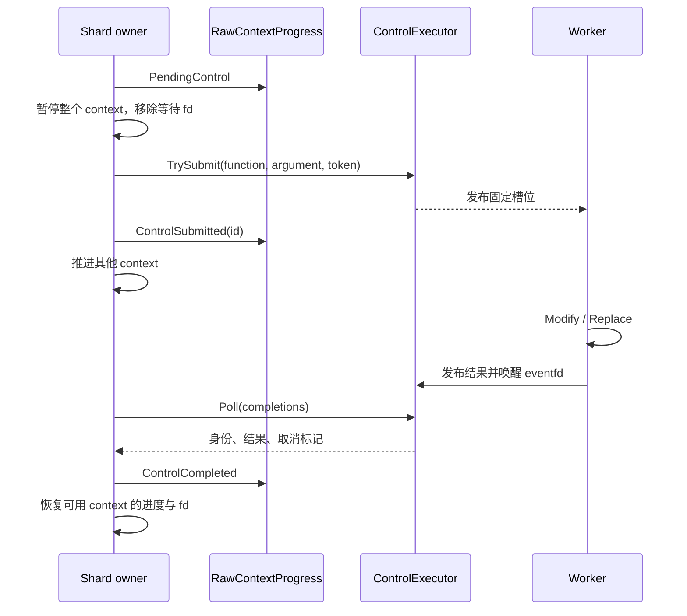

# RuntimeShard 进度器

`RuntimeShard` 将已经创建的 raw context、队列池、RX 缓冲池和 TX 账本绑定到一个 owner，统一推进收发、补投、事件和慢控制任务。它拥有反应堆与控制执行器，借用全部 URMA/DMA 对象；`Open` 不负责创建连接、分配 Grant、授信或创建完整 raw runtime。

本实现对应 [roadmap M3](roadmap.md#m3runtimeshard-反应堆4-context-轮询与异步事件引擎)。M4.1 已通过可选 hooks 接入 [LeaseReturnProgress](memory-leases.md)，负责注册 Slab 的跨线程 CPU Lease 归还；M5.2 已提供 [Eager Connection](eager-connection.md) 与物理 Credit 接线；M5.3.1 已通过 [连接 Runtime](connection-runtime.md) 接通 context 暂停组、连接进度、导入和动态 fd；自动资源创建、完整 MemoryManager 和 WRITE RNDV 仍按后续阶段交付。当前无 UB 真机回归，也未据 Mock 结果新增硬件 PASS。

## 组件与容量

| 组件 | 责任 | 当前边界 |
| --- | --- | --- |
| [`RuntimeShard`](../kbsocket/runtime/runtime_shard.hpp) | 绑定 raw context，组合反应堆与控制执行器 | 每 shard 1–4 个 raw context；可承载两个裸设备各两个 EID；仅 TCP 时允许 0 个 raw context 加 hooks |
| [`RawContextProgress`](../kbsocket/runtime/raw_context_progress.hpp) | 一个 context 的唯一 async 消费者；驱动绑定域的 TX/RX/refill/flush 与通知 | 每 context 1–8 个独立接收域、每域最多 64 条主动 Lane；进程内 async 消费者登记表最多 64 个 context |
| [`ShardReactor`](../kbsocket/runtime/shard_reactor.hpp) | 公平预算、轮询/事件双模式、控制提交和完成收割 | 最多 8 个 source、80 个 source fd；RuntimeShard 使用最多 4 个 context group 和 1 个可选 hooks source；动态连接 fd 在组内汇聚 |
| [`ControlExecutor`](../kbsocket/runtime/control_executor.hpp) | 执行可能阻塞的控制函数，将结果交回 owner | 固定 1–4 个 worker、1–4096 个槽位，worker 数不得大于槽位数 |
| [`ProgressSource`](../kbsocket/runtime/progress_source.hpp) | 宿主接入有界 mailbox/timer/retire 等进度 | M4.1 的 `LeaseReturnProgress` 使用 mailbox 预算处理 CPU 归还；M5.3.1 的 ConnectionProgress 使用 mailbox/timer 预算推进连接；没有通用业务 mailbox 或 Grant 协议实现 |

配置的上限是显式资源限制，不能据此推断吞吐或 40k 连接容量已经通过验收。`ControlExecutorConfig` 默认 1 个 worker、64 个槽位；所有排队、执行中以及完成但尚未被收割的任务都占用槽位。`ReactorConfig` 默认 `events=false`、`budget=32`、`busy_poll_ns=50000`、`max_wait_ms=10`；预算允许 1–64，单次等待允许 0–1000 ms。

## owner 与资源责任

宿主先在控制路径创建 `UrmaContext`、`JettyPool`、`RxBufferPool` 和 `AttemptLedger`，再构造 `RawQueueBinding`。每个绑定的 pool、RX 与 ledger 必须属于同一 context/池；重复 pool 或重复 async owner 被拒绝。事件模式要求各 pool 创建有效 JFCE，注册期间所有 fd 保持有效且身份不变。

`RuntimeShard` 的推进、替换请求、统计访问和关闭由同一 owner 串行执行。TX/RX/async/error 回调也在该 owner 上同步执行，不得阻塞、重入或销毁依赖。RX 回调必须接收并最终归还全部 `RxBufferLease`；TX 回调只表示本地 WR 的完成，不会生成远端 credits。跨线程生产者只能在宿主自己的发布协议完成后调用 `Notify` 唤醒，不能并发访问 raw 句柄；`Notify` 与关闭 fd 的生命周期也必须由宿主协调。

控制任务会访问 raw 对象，因此提交前冻结整个 context 的访问，而非仅冻结一个 Lane。该 context 的全部 TX/RX/refill/flush、JFC 通知和 async 消费暂停，相关 fd 暂时移出等待集合。控制完成经 owner 收割后才恢复。宿主的外部借用者同样不能在此期间投递、poll、归还 Lease 或删除对象；其他 context 可以继续推进。

`LeaseReturnProgress` 可作为 `RuntimeShard::Open` 的 hooks source，独占消费一个 `LeaseReturnQueue`，归还回调在 owner 的 mailbox 预算内执行。它只解除 `SlabAllocator` 的 CPU 持有，不操作 raw 队列或自动结清 DMA/Grant，因此 raw context 控制任务期间仍可推进。Slab 注册/注销本身是控制路径，须排除全部相关 context 和 Lease 使用者的并发访问；当前 adapter 不自动安排这些任务。归还源也不接受 `RxBufferPool` 的 `RxBufferLease`，两套 backing 尚未合并。



## 公平推进与等待

`Tick()` 进行一次有界推进，不等待 worker。先收割控制完成，再按 async、TX、RX、refill、flush、mailbox、timer、retire 分类推进，每个 source 的每类各有独立预算，下一次 Tick 轮换起始 source。raw source 内部也轮换域；热 TX 或持续错误不能直接耗尽另一类的预算。

`RunOnce()` 在默认配置下执行同样的轮询。启用事件模式后，只有持续空闲达到 `busy_poll_ns`，才对可用 JFC 执行 `Rearm`，随后完整 recheck；发现 CQE、待推进工作或控制完成就继续处理，不进入等待。最后仍无工作才进行有限时长的 `epoll_wait`。跨线程 wake 在首次检查前消费，最后 recheck 后不再清除，避免丢失刚发布的唤醒。

JFCE fd readiness、JFC 通知和 CQE 是三种不同证据。`WaitJfc(..., timeout=0)` 取得的每项通知分别 `AckJfc`，重复项不能去重，未知归属的有效返回对象也须 Ack。即使 recheck 已取得 CQE、最终没有睡眠，也会收割通知。控制执行器的 eventfd 由执行器独占消费；外部只注册 readiness，不能直接 read/write/close。

## async、水线与故障

每个 context 只有一个 async 消费者；async fd 可读后才调用 `GetAsyncEvent`。每次成功 Get 先复制事件字段、恰好 Ack 一次，再用副本核对 context 和对象身份；未知事件只报告原始观测，不能解引用未经核验的 union 指针，也不能据其隔离某个 Lane。

| 事件/失败 | 当前处理 |
| --- | --- |
| `JFR_LIMIT` | Ack 后设置 `watermark_pending`，保留重写责任 |
| 主动 Lane 的 `JETTY_ERR`、可信 TX 致命错误 | owner 先 `MarkFaulted` 停止该 Lane 新准入；控制任务执行 `BeginDrain`，随后普通 CQE/边界/软件 flush 继续归账 |
| TX status 8 或 10 | 只退休可信的当前 WR，并交付原始错误；不因该 WR 无条件排空整条 SQ |
| `JFC_ERR`、`JFR_ERR`、被动端点错误 | 保留关联域的全部依赖，停止其队列进度；健康独立域继续运行 |
| CQ poll 失败、RX 接受情况未知等无法证明安全的失败 | 保留关联域，不能用推测完成释放 DMA 内存 |

保留域仍可识别和 Ack 已取得的相关 async 事件，但不会在线恢复故障 CQ、猜测缺失 CQE 或销毁尚无终结证明的资源。没有 `PORT_DOWN` AE 不代表链路健康。

`watermark_threshold=0` 禁用自动水线重写。非零值必须小于 JFR 深度；初始化和每次 `JFR_LIMIT` 都保留重写责任，只有 RX 账本的 posted **严格高于**水线且 RX 未停止时才提交 `ModifyJfr`。Held 未归还时保持 pending；Lease 归还、补投成功后再尝试，不会在低水位不断重写制造事件循环。

每次 refill 只使用现有空闲槽位，不为凑足批量延后投递。已知接受前缀的 `EAGAIN` 记录已接受数量并按 `kRetryNs=1 ms` 延后重试；即使没有新 CQE，后续 Tick/有限等待仍会检查。控制失败也保留请求并延后重试，失败结果经回调报告；是否恢复业务连接不由此层决定。

## 控制任务与 Lane 替换

执行器使用 `noexcept` 函数指针、`void*` 参数和 token，不使用 `std::function`。`Open` 预分配槽位和固定线程，提交/取消/收割不分配、不持互斥锁、不等待工作函数；满额立即返回 `kResourceExhausted`。`ControlTaskId` 包含执行器身份、槽位和单调序号，拒绝跨执行器、旧槽位和同对象重开前的取消请求；序号耗尽返回独立 `kSequenceExhausted`，不会回绕或伪装成暂时满额。

取消只标记结果，已经接受的任务仍然执行；无论成功、失败或取消，owner 都必须收割完成并处理新建资源或半成品。调用方一直持有参数及其依赖到收割结束。`RawContextProgress` 对取消后的控制结果保留关联域，不恢复可能已经变更的对象。

`RuntimeShard::RequestReplacement(context, lane, proof)` 不自动推断屏障。调用方必须确认该 Lane 已排空，并给出 `events_acked`、`queue_users_stopped` 和 `completions_drained`；空 CQ、软件票据归零或暂时没收到事件都不能单独代替证明。请求随后交给控制线程执行 `ReplaceDrainedLane`，删除/创建失败保留阶段和请求供重试，成功后发布新 generation。其他 Lane 与固定被动端点不因该替换改变身份；失败业务不自动重放。

## 关闭与 M1 的衔接

`RuntimeShard::StopAccepting()` 停止新的控制任务提交，不等于停止 raw TX 准入，也不代表远端已经静默。宿主须继续执行自己的连接关闭和队列停用协议。

`RuntimeShard::Close()` 只解除进度器绑定，不删除借用的 Jetty/JFR/JFC/MR。存在已接受控制任务时返回 `kInUse`，宿主继续 `Tick()` 收割后重试；未提交的水线或替换意图在解绑时撤销。全部控制完成收割后，执行器才停止并 join 空闲 worker；它不会为了关闭而等待正在阻塞的任务。

M1 的 `ReceiveDomainCloser` 仍由宿主提供远端静默、事件确认、队列用户停止和 CQ 健康证明，并在控制路径推进。涉及删除时，必须先停用对应进度绑定并排除外部借用，避免事件循环或 worker 同时访问即将销毁的对象。顺序仍是删除所有关联 Jetty、删除 JFR、清退残留 Posted、等待 Held 归还，再注销 MR、删除 JFC，最后删除 JFCE；详情见 [设计 §5.3](design/kbsocket-design-v1.md#53-接收域安全关闭状态机m1-核心规范)。M3 没有新增能够代替这些证明的自动关闭流程。

正常调用必须显式 Close。若异常析构时控制任务仍未终结，`RuntimeShard` 保留内部 State（含进度源、任务参数和线程），`ControlExecutor` 同样保留其内部槽位/线程/FD，避免 worker 访问已释放内部对象。**保留内部 State 不接管借用 raw 对象、回调 cookie 或外部任务参数**；调用方仍必须让全部依赖存活，无法取得终结证明时保持隔离，不能在析构后释放这些依赖。

## 验证

2026-11-07 统一验证：37 个测试目标、657 个用例通过，其中 runtime 4 个目标/48 个用例、raw 9 个目标/164 个用例、工具 24 个目标/445 个用例；真机回归未执行。相关无硬件测试位于 `kbsocket/runtime/*_test.cpp`：

- 执行器：满额包含未收割完成、慢任务期间 owner 不阻塞且零分配、限额 Poll 后通知仍可读、取消结果交付、身份隔离、分配/FD/线程创建失败回滚和关闭重试。
- 反应堆：四 source 分类预算、热源公平性、Poll/Rearm/Recheck、通知合并及最后复查后的唤醒、控制满额/慢任务与关闭。
- raw 绑定：补投、水线待处理、async 归属和 Get/Ack、TX 边界排空、故障域保留、控制线程执行修改与失败重试。
- shard 集成：四 context TX/RX、补投、通知 Ack 与 status 8 后继续完成、慢控制只暂停一个 context、解绑不删除 raw 资源、部分 Open 失败回滚。

```bash
bazel test //kbsocket/runtime:all //kbsocket/transport/raw:all //tools/... --test_output=errors
```

Mock 能检查调用顺序、资源身份与安全门禁，不能证明真机延迟、调度性能或新的硬件通知行为；这些继续按[硬件验证矩阵](hardware-validation-matrix.md)记录。

## M5.2 连接层接线

绑定 `EagerReceiveDomain` 的队列必须设置 `RawQueueBinding.external_refill=true`，由宿主在相同 owner 上有界推进该域的 `Refill`，确保可信 post 前缀与物理 Credit 同时结账；原源继续独占 CQ 和通知消费。连接发送使用 `TxSender::Open(ledger, true)`，post 接受未知或账务错误仅 `MarkFaulted`，由既有控制任务执行 `BeginDrain`，不能在数据推进中同步 ModifyJetty。M5.3.1 已由 `ConnectionProgress` / `ConnectionIoBinding` 接入 Connection/Credit 调度与动态控制 fd，`ImportProgress` 与其共享完整 context 暂停范围；来源登记、接线与关闭顺序见 [连接 Runtime](connection-runtime.md)。
