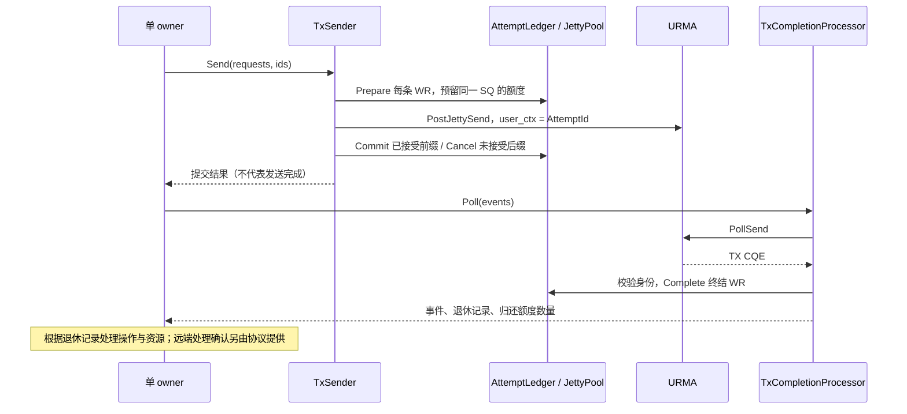
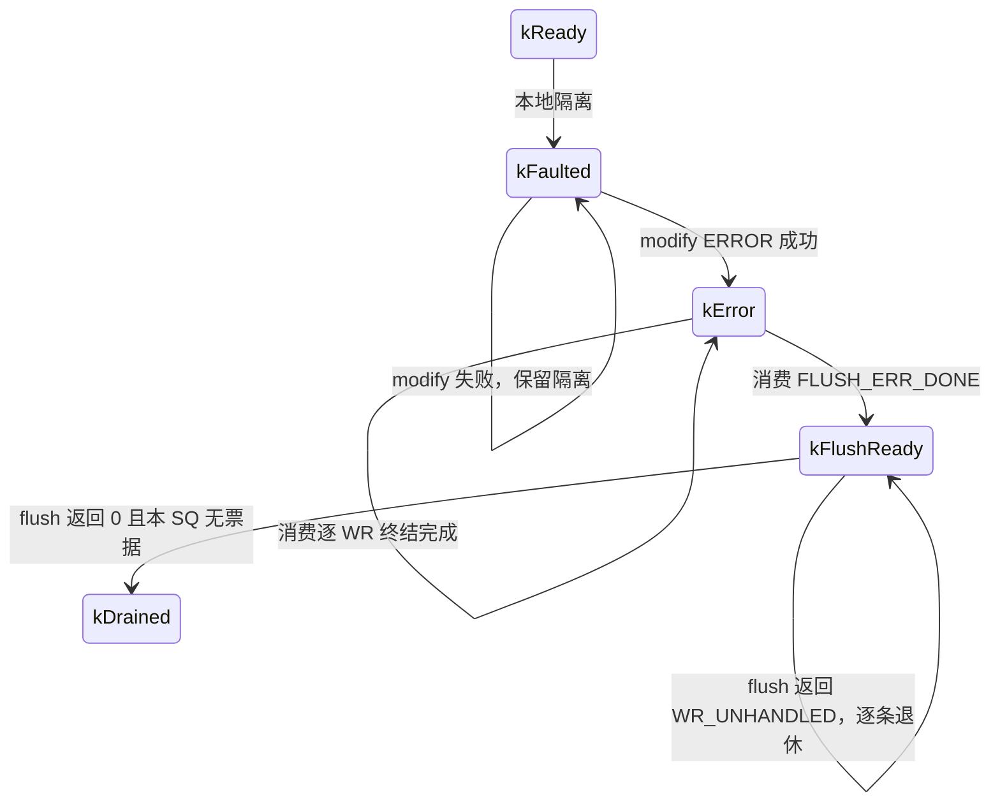

# TX 提交、记账与完成回收

[文档入口](README.md) · [当前代码流程](raw-transport-flow.md)

三个组件共用同一个 owner，分别承担以下职责：

| 组件                                                                           | 负责                                      | 不负责                             |
|--------------------------------------------------------------------------------|-------------------------------------------|------------------------------------|
| [AttemptLedger](../kbsocket/transport/raw/attempt_ledger.hpp)                  | 将 AttemptId 关联到池票据、操作和资源引用 | 投递、解析 CQE、释放真实 buffer    |
| [TxSender](../kbsocket/transport/raw/tx_sender.hpp)                            | 整批预留、构造 WR、post、按接受前缀记账   | poll、自动重试、socket 可写通知    |
| [TxCompletionProcessor](../kbsocket/transport/raw/tx_completion_processor.hpp) | poll TX JFC、切 ERROR、按边界软件 flush、核验并退休终结 WR | 远端业务 ACK、在线重建或重放 |

## 容量与背压的读法

`Prepare` 同时需要账本槽位和 SQ 额度。当前 Sender 要求整批放入同一 SQ；即使池的总剩余额度足够，也可能因选中的 SQ 放不下整批而在 post 前失败。调用方应保留未提交工作，推进完成后再决定何时提交。

单 SQ 的 `tx_depth=256` 限制同时预留/在途的 WR 数量；若每条 WR 是 4 KiB，对应这一时刻最多 1 MiB，并不是连接累计发送量或协议消息大小的上限。持续 poll、回收额度后可以继续发送。拆批及大消息分片仍由上层完成。

已知接受边界的 `URMA_EAGAIN` 是普通提交失败，不会独自令 `blocked_` 置位。`blocked_` 表示接受范围不可信或内部记账失败，此时不能通过重新 Open 就认为旧请求已安全消失。当前没有 `errno=EAGAIN` 的 socket 适配、等待队列或 `NotifyWritable()`；退休额度只是后续实现可写通知的输入。

[背压硬件工具](../tools/backpressure_test/README.md) 分别验证本地 SQ 配额与远端 RX 延迟：`tx_quota` 将账本容量设为 `tx_depth+1`，暂停 TX poll 后验证额外 WR 在 SQ 预留阶段被拒绝，再退休前一批并提交这条未被接受的 WR。`rx_delay` 则先接受发送，再延迟补投远端 RX，区分成功完成与异步错误排空。该实验使用专用单连接 SQ；任何错误终结后，若 SQ 仍为 READY，工具显式调用 `BeginDrain` 关闭本轮 SQ，再通过另一 SQ 清理 RX，保留既有终结报告格式。这是实验的关闭决策，不表示 status 8 必须导致生产共享 SQ 整体排空。两者都不要求 provider 返回 `URMA_EAGAIN`；同步 post 失败单独报告，不冒充本地配额拒绝。用户已确认两组硬件测试通过，其中 `rx_delay` 观察到原始 WR 全部 RNR、另一条 SQ 的清理消息全部成功。

`rnr_continue` 单独验证 error continue 下同一条 SQ 在 RNR 后是否仍能发送：服务端不投 RX，等客户端逐条收到全批 RNR 后再补投；客户端不切 ERROR，使用同一 jetty 提交具有新身份的第二批消息，要求全部成功且远端 payload 校验通过。该模式只在工具内直接消费 TX CQE 并退休账本，避免生产 `TxCompletionProcessor` 对 RNR 的主动排空改变实验条件。提交前、首批 RNR 后、第二批成功后均通过 `QueryJetty` 检查 READY。用户已反馈 `rnr_continue_success`，证明本次硬件与配置下 RNR 终结原始 WR 后，同一条 SQ 仍能成功发送新消息；生产侧对 RNR 仍主动排空。后续 status 8 同 SQ 隔离已有独立实测，不能将 RNR 结果本身推广到其他错误；证据与限制见 [硬件观测记录](hardware-observations.md)。

## AttemptLedger 发送账本

Bazel 目标为 `//kbsocket/transport/raw:attempt_ledger`。账本绑定一个 JettyPool，由相同 owner 推进。`Open(pool, capacity)` 预分配固定数量记录；容量不足在 post 前失败，不动态扩容。通常按池内发送额度总量设置容量。

使用顺序：

1. `Prepare(metadata, optional_lane)` 预留账本和 SQ 额度，返回可写入 WR `user_ctx` 的 `AttemptId`。通过 `Lookup(id)` 读取 ticket，使用 `pool.Get(ticket.lane)` 取得队列。Prepare 失败不接管目标和资源引用。
2. 提交层将 metadata 对应目标、opcode 写入 WR，确保启用完成通知，执行 post；已接受部分调用 `Commit(id, submission_sequence)`，未接受后缀调用 `Cancel(id)`。预留顺序不等于实际提交顺序，提交位置由提交层明确传入。
3. 完成层确认某条 WR 已终结且 DMA 不再访问其资源后调用 `Complete(id)`，取得原始记录，再分发结果并处理 buffer/grant 租约。SQ 额度归还不代表协议 grant 自动撤销；远端授权生命周期仍由上层协议决定。

记录保存连接、操作及其代次、远端目标、opcode、buffer/grant 租约标识，以及 lane epoch、票据、逻辑提交位置。尚无统一资源租约实现，因此账本保存的是引用标识，不会自动释放内存或 unimport 目标。上层资源表必须保持引用直到返回退休记录，且根据协议判断是否可以真正回收。

AttemptId 在同一账本对象存活期间单调增加且不回绕，Close/Open 不重置，按容量取模直接定位槽位；预留跳过仍占用的槽，最坏扫描 capacity 次，查询和退休为 O(1)。不同账本的 id 不保证唯一，CQ 路由必须先确定所属账本；票据仅经账本流转，不能再直接调用池的 Commit/Cancel/Complete。

首版只接受全 signal 记录，不解析 CQE 状态、不自动 post、不实现 selective signaling 或累计成功推导。连接关闭、队列故障、`FLUSH_ERR_DONE` 本身都不能触发账本整体清空。Close 在有预留或在途记录时拒绝关闭；进程退出仍有工作线程时，账本、队列及资源表必须一起常驻。对象销毁后不得再使用旧 id。

## TxSender SEND 提交器

Bazel 目标为 `//kbsocket/transport/raw:tx_sender`。同一个账本由一个 TxSender 管理提交顺序，与 post、poll、账本修改共用单 owner。WR 描述符内嵌于 `std::array`，`Open(ledger)` 仅绑定账本，不分配内存；单次请求数量由调用方传入的 span 决定，硬上限 `TxSender::kMaxBatch = 256` 对齐 UMQ 的 `UMQ_BATCH_SIZE`；之后 `Send(requests, ids, optional_lane)` 不分配内存、不加锁、不自动重试。单条发送使用长度为 1 的 span。

每条请求携带 AttemptMetadata 和本地已注册内存的 SGE。目前支持非 inline 的普通 SEND 与 SEND_WITH_IMM，允许同批混合，强制全 signal，不支持 READ/WRITE 或 jetty group。`metadata.opcode` 选择 `URMA_OPC_SEND` 或 `URMA_OPC_SEND_IMM`；后者将 `imm_data` 按 URMA 契约以主机字节序完整传递为 64 位值，普通 SEND 忽略该字段。发送器不规定 IMM 的连接标识或 SN 位布局。目标必须由宿主正确导入为当前 context 的 RM_CTP 端点，注册段、payload 和目标必须覆盖在途 attempt 生命周期；SGE 描述符仅需覆盖 Send 调用。

一批 WR 在同一个 SQ 上 post，逐条设置远端目标和 `user_ctx = AttemptId`。未指定 lane 时由第一个预留选择 SQ，余下请求固定在该 SQ 上预留；不会跨 SQ 拆分或因容量不足自动换队列。整批预留失败时撤销本批已有预留，不调用 provider；不会影响此前已在途的记录。

同 SQ 提交只确定本地提交与记账顺序，不保证同一远端按此顺序收到 SEND。用户已确认当前 RM_CTP 默认存在这一乱序可能；TxSender 不承担保序，上层连接协议须携带 SN/字节位置并在接收端重排。JFS fence order 不作为默认保序方案，见 [连接内顺序设计](design/kbsocket-design-v1.md#6-连接内顺序保留薄适配不构建重放协议)。

调用方预分配至少 requests.size() 个 ids。正常成功返回提交数量；普通 post 失败返回 `TxSendError`，其中 accepted 是硬件已接受的前缀长度，provider_status 保留原始返回值。前缀完成 Commit 并保留 id；后缀被 Cancel，对应 id 为 0，可以由上层决定是否再次提交。发送器只归还未接受请求的额度，不自动释放任何 buffer/grant，也不回放已接受前缀。完成层仍通过账本处理返回 id 对应的最终结果。

输入长度或就绪状态检查失败时 ids 不变；通过这些检查后对应范围会清零并填入仍保留的记录身份。不要将上一批仍需使用的 ids 缓冲区作为下一批输出，须先将其转存到操作记录。不能把 expected 失败统一理解为“零条被接受”。

若 provider 失败却没有有效 `bad_wr`，或成功时返回了矛盾的 `bad_wr`，accepted 为 nullopt：整批身份与 Prepared 记录都保留，SQ 先禁止发送，再尝试修改为 ERROR，发送器停止发送；修改失败保存在 pool_error 中。此时不能自动 Cancel 或重试整批，需获得可信的未提交/终结证据后恢复。post 后记账异常同样保留非零 id、停止发送并尝试切 ERROR。调用方不得在 provider 回调中操作账本或票据；调用方负责保证单 owner 且不可重入，Send 执行期间不得调用 Open/Close，内部不做重入检查。

TxSender 的 Close 只解除绑定，不退休账本请求；关闭提交器后在途 buffer、目标、账本和池仍须继续存活。更换或重新打开账本前先关闭提交器。TX CQE 由下述 TxCompletionProcessor 处理；资源仍由上层回收；基础 SEND 成功路径已通过 [双端硬件测试](../tools/send_test/README.md)，不代表错误和排空路径也已完成硬件验证。

## TX completion 推进与额度回收

`//kbsocket/transport/raw:tx_completion_processor` 提供 `TxCompletionProcessor(ledger)`。同一个 owner 使用它独占消费所属池的 TX JFC，传入预分配的 `TxCompletionEvent` 数组调用 `Poll(events)`，每次最多处理 64 条。内部 CQE 数组固定存储，无动态分配、业务回调或互斥锁。账本必须管理该 TX CQ 的全部 attempt；不能用多个独立账本复用同一 CQ 并各自轮询。

Poll 的 expected 错误表示本次未成功取得 CQE；成功结果包含 `count` 和 `retired`。每个已取出的 CQE 都对应一个输出事件，单条异常不会让后续有效 CQE 被丢弃。必须同时检查事件的 record 与 error：modify 失败时，合法的终结 CQE 仍返回退休记录，同时报告硬件状态转换错误。事件类型如下：

- `kCompleted`：已按 user_ctx、local_id、lane epoch 验证归属，并执行 ledger.Complete 归还额度。record 保存原始连接、操作和资源引用；completion.status 区分成功和具体 WR 错误。仅此类事件增加 retired。
- `kFlushDone` / `kSuspendDone`：公共 URMA 状态定义中的假 CQE 边界，user_ctx 无效；输出中将其清零，不查账本、不退休其他 WR。
- `kRejected`：方向/对象类型不符、未知队列、重复或未知 id、通道不匹配、未提交记录或不支持的状态。原始 CQE 与错误信息交给上层诊断，不猜测完成范围、不释放其资源。

合法的 `REM_ACCESS_ABORT_ERR`（status 8）完成只退休对应 WR，保留原始 `completion.status` 和 `AttemptRecord` 返回上层，不因该状态调用 `BeginDrain` 或主动 modify ERROR。它表示远端访问中止这一错误类别，不能唯一归因为进程退出；连接与操作的失败决策由上层依据 record 处理，本层不自动关闭连接、不重试，也不把错误改写为 SUCCESS。SQ 若已因其他原因隔离，不会因为后续 status 8 恢复可发送。

其余普通终结错误仍先隔离该 SQ，再主动 modify 为 ERROR；RNR、ACK_TIMEOUT 和本地访问错误等策略本轮未改。只标记本地故障不足以停止 error continue 模式的硬件。首版不做 suspend/resume 或在线恢复；其他在途 WR 仍需各自的终结证据。已隔离队列仍可通过 local_id 查找并处理尾部完成。`WR_FLUSH_ERR` 是具体 WR 的终结错误，可退休对应记录；`FLUSH_ERR_DONE` 不能推导整个账本已经排空。`WR_UNHANDLED` 属于显式 urma_flush_jetty 返回语义，不作为普通 poll 的终结依据。

用户于 2026-10-23 补充确认：status 9 后可删除旧 jetty 并重新创建，无需仅因这一错误重建整个 context；jetty 异常不影响正常 JFC 上的排空流程。因此 ACK_TIMEOUT 继续采用阻止新提交并排空旧请求的策略，重建时须分配新代次，不重放旧请求。在线替换尚未实现；该契约也不覆盖 JFC 自身故障后的终结与回收。

收到合法 kFlushDone 后，owner 可调用 Flush(lane, events) 分批处理软件残留 WR，见下节。此层不调度后台排空、不处理异步事件或自动销毁故障队列。错误完成不是连接级 ACK，也不能自动宣称同 SQ 上其他连接全部失败或全部完成。

正常发送闭环为 `TxSender.Send → provider → TxCompletionProcessor.Poll → ledger.Complete → pool 额度归还`。上层可在 retired 非零后推进发送等待队列；这只是资源变化，不保证某个 socket 已满足所有可写条件。当前未接 socket/epoll 的 NotifyWritable，也不自动释放 buffer/grant 或重试未提交工作。

## error continue 与单 SQ 故障排空

创建 jetty 时保留 `error_suspend` 的默认值 0，即 error continue 模式。普通错误完成不代表 SQ 已经停机；即使 jetty 已处于 ERROR，底层 post 仍可能返回 URMA_SUCCESS，所以禁止发送必须由本地状态保证，不能等待 provider 拒绝。

本实现采用以下契约：

1. `JettyPool::BeginDrain(lane)` 先阻断 Reserve/ReserveOn/Get，再调用 `ModifyJetty`，属性为 `mask=JETTY_STATE, state=URMA_JETTY_STATE_ERROR`。modify 失败保留隔离状态，owner 可显式重试；成功后重复调用不重复 modify。
2. owner 继续 poll 共享 TX JFC。该 SQ 的 `WR_FLUSH_ERR` 是逐 WR 的终结错误，user_ctx 有效，照常核验身份并退休。
3. 后续 `WR_FLUSH_ERR_DONE` 只标记硬件 FLUSH_ERR 的终结，user_ctx 无效，输出始终清零。只有本地已切 ERROR 才接受此边界；意外或重复边界返回拒绝事件，不清空任何记录。
4. owner 在收到 kFlushDone 后调用 `TxCompletionProcessor::Flush(lane, events)`。实际请求数量为 `min(events.size(), 64, tx_depth)`：liburma 要求 flush 数量不超过单个 SQ 深度，不能直接沿用共享 CQ 的 poll 缓冲大小；票据已清零时也用合法正数请求来确认软件队列为空。仅接受指定 SQ、TX jetty 方向、状态 `WR_UNHANDLED` 且匹配活跃已提交记录的返回项。普通 poll 中的 WR_UNHANDLED 仍不作为退休依据。
5. 每条合法软件完成通过 ledger.Complete 归还额度并返回资源引用。重复、未知、错误通道或 Prepared 记录均拒绝；不会因为一条错误丢弃同批后续合法返回项。
6. 持续 Flush，直到返回 count=0 且无错误。只有 provider 返回 0 且该 SQ 没有残留票据才标记排空；其他 SQ 仍有在途请求不会妨碍此 SQ 排空。已排空 jetty 永久不可发送，本版不在线重建。

`MarkFaulted` 仅执行本地隔离，硬件排空使用 BeginDrain。除合法 `REM_ACCESS_ABORT_ERR` 外的普通终结错误 CQE，以及 TxSender 在 post 后遇到接受边界不可信或记账异常时，已接入 BeginDrain。status 8 例外不放宽 CQE 身份、方向、lane epoch 或账本校验。外部故障检测也可由同一 owner 显式调用 BeginDrain；禁止绕过池直接 modify 后继续使用缓存的 jetty 指针。

`Flush` 的 expected 错误表示参数、状态或 provider 调用失败，也包括 provider 已空但池票据仍有残留的 kInUse；它不自动丢弃资源或继续重试。Poll 返回 completed 事件也可能携带 modify 失败：调用方应先接收退休记录，再处理控制错误。需要用事件中的 lane 重试 BeginDrain，并继续 Poll 等待边界。

本契约已对照本地 UDMA 的 `udma_u_parse_cqe_for_send`（消费边界后设置 flush_flag）、`udma_u_flush_jetty`、`udma_u_flush_sq`（产生 WR_UNHANDLED），以及 UMQ 的 `tx_flush_done` 门禁。当前公共 `urma_api.h` 中 flush 返回 FLUSH_ERR 的注释与该 provider 实现不一致；本层按此处明确的 raw 契约实现，其他返回状态会被拒绝。

### 当前范围与验证

本版排空已提交的、全 signal 的 SEND/SEND_WITH_IMM，不会从一个边界或空 flush 推导所有请求已结束。post 接受范围不可信时，TxSender 留下的 Prepared 记录仍保留；本版没有增加“不确定提交”状态及其证据对账，因此不会自动 Cancel 或 Complete 它们。这类异常仍须保留依赖资源，不能宣称排空成功。

单测覆盖正常错误 → modify → FLUSH_ERR → FLUSH_ERR_DONE → WR_UNHANDLED → 排空、modify/flush 失败与重试、错误/重复边界、错误完成身份、残留票据，以及共享 JFC 中健康 SQ 继续发送。Close 在仍有票据、等待硬件边界或尚未确认软件队列为空时拒绝关闭并保留 poll 能力。

[独立 TX 排空工具](../tools/tx_drain_test/README.md) 和 [同池 SQ 故障隔离工具](../tools/sq_isolation_test/README.md) 已获得用户的真实硬件通过反馈，后者观察到了非零 `FLUSH_ERR`，且健康 SQ 和共享 RX 保持可用。后续 [provider 边界实验](../tools/provider_boundary_test/README.md) 的 P4 已观察到非零 `WR_UNHANDLED`，但聚合计数尚未严格对应到那一条 ERROR probe。生产侧异步事件与排空调度仍未实现。基础 SEND 工具遇到这类错误仍按原策略失败并保留无法安全释放的资源；硬件记录见 [硬件观测记录](hardware-observations.md)。
